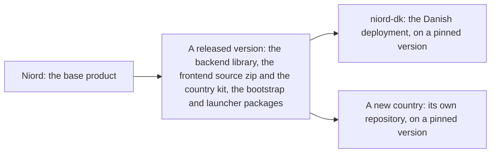

# Niord

Niord is the maritime safety information system for Navigational Warnings and Notices to
Mariners: the NW and NM T&P editing and publishing system. This repository holds the whole
product, backend and frontend:

- **`be/`** — Spring Boot 4 backend (Maven reactor: `niord/` country-neutral base
  library + `niord-app/` generic English application; a country application, such as the Danish one in
  `SIFA-DK/niord-dk`, is a repository of its own, built on the published library).
- **`fe/`** — Angular 22 workspace with two applications: the administration
  web app (`fe/ui-apps/admin/`) and the public site for mariners (`fe/ui-apps/info/`),
  which ships as a container image of its own.
- **`country-kit/`** — the country kit, beside `fe/`: the set-up, `init`, the pack tools and
  checks a country repository builds its frontend with, its guides and the example country,
  published as its own package, `org.niord:niord-country-kit`, at the same version as the frontend
  source zip `org.niord.web:niord-fe-src` ([`country-kit/README.md`](country-kit/README.md)).

## The base product and its countries

This repository is the **base product**: the whole system, the same for every country and knowing none of
them. Each country that runs Niord is a repository of its own on top of it. A country pins one
released version of the base product and adds only what makes its deployment its own: its
configuration, branding, languages, texts and starting data. It never copies or edits the base
product's code.

So a fix, a security fix or a new feature made here reaches every country when it moves to the
new version, and a country's own choices stay in its repository through every upgrade.



- The Danish deployment is built this way in `SIFA-DK/niord-dk`, a repository that is not public yet.
- To start a country, read the guides in [`country-kit/docs/`](country-kit/docs/README.md):
  the idea in more detail, the country guide's standard path (`init` from a handful of answers,
  then make it yours and deploy) and its in-depth companion, the designers' brief and the
  operators' guide.
- How the base product is released (one shared version per merge) is in
  [`be/docs/cicd/design.md`](be/docs/cicd/design.md); the model behind the split, a base product that
  knows no country and the contracts a country builds on, is in
  [`docs/fe-country-split-plan.md`](docs/fe-country-split-plan.md).

## Try it

This starts the base product on its own: the generic English application with its sample content.
A country runs from its own repository, with its own `./start-local.sh`.

You need JDK 25 (`JAVA_HOME` pointing at it, or Temurin 25 unpacked into `~/.jdks/temurin-25`),
Node 24 (24.15.0 or later) with npm 11, and Docker Desktop running (on Windows, use Git Bash).
Then, from the repository's root:

```bash
./start-local.sh --sample
```

The first run builds the backend, which takes a few minutes. When it is done, it prints:

- the administration app on http://localhost:4100 and the public site on http://localhost:4400;
- the logins `sysadmin`, `admin`, `editor` and `user`, each with its name as password;
- MailHog on http://localhost:8025, which catches every mail the backend sends.

The content is Danish sample data: domains, series, charts, areas, publications and a few dozen
messages, every one titled "SAMPLE —". The texts are in English and Danish; the Danish ones show
once a sysadmin adds `da` to the model languages on the Settings page and reloads the page. Ctrl+C
stops it; running the command again starts it again with its data, and
`./start-local.sh --sample --reset` starts from scratch. The sample is loaded once, so after a
`git pull` that changes it, `--reset` loads the new one. The repository files (attachments, publication
files) are rows of the database, so a local database from the days they were files under the Niord home's `repo/`
answers 404 for every attachment until a sysadmin runs the `repo-import` batch job once against that folder
(`POST /rest/batch/repo-import` with `{"dir": "<home>/repo"}`), or `--sample --reset` starts over.

This is a local trial on this machine only: Keycloak runs in development mode with known passwords,
so never expose it. A country deploys with the Helm chart (`be/k8s/`).

## CI

GitHub Actions only reads workflows from `.github/workflows/` at the **root** of a repository, so
that is the only place a workflow in this repository does anything: a `.github/` directory under
`be/` or `fe/` would be inert.

| Workflow | Trigger | Jobs |
|---|---|---|
| [`.github/workflows/be-ci.yml`](.github/workflows/be-ci.yml) | every pull request; pushes to `main` touching `be/**` outside its documentation (`be/docs/`, Markdown under `be/` — except under `src/test/resources`, where a test may read it), `publish.yml`, or the frontend files the backend reads (the portrayal definition `fe/shared-map/portrayal/**`, `fe/shared-html/message-html-classes.ts`) | unit tests (~2 min) with the no-sample check over the built jars, integration tests (~7 min), and the Generated country (`init`'s untouched country's backend built with Maven on Docker, when a pull request changes the scaffold's inputs and on every push to `main`) |
| [`.github/workflows/fe-ci.yml`](.github/workflows/fe-ci.yml) | every pull request; pushes to `main` touching `fe/**` outside `fe/ui-apps/info/`, the kit `country-kit/**`, `publish.yml` or `retract-version.yml` (the guard tests run their bash) | three work jobs: checks + builds (format, docs, paths, contents, lint, the scripts' lint, guard tests, build with its URL check), the unit tests, and the Example country (the kit's example built against a source zip of the branch, `init`'s untouched country (its backend built too when the scaffold's inputs change), the fixture upgrade and the upgrade test); and the `Frontend gate` |
| [`.github/workflows/info-ci.yml`](.github/workflows/info-ci.yml) | every pull request; pushes to `main` touching the public site or what its jobs read | the public site, in one work job: checks + builds (format, docs, lint, guard tests, unit tests, build with the paths, contents, URL, separation and first-visit checks), and the `Info gate` |
| [`.github/workflows/publish.yml`](.github/workflows/publish.yml) | after Backend CI, Frontend CI or Info CI completes for a push to `main` (the zip carries the public site, so a merge confined to it publishes too); a labelled break-glass run by hand, from `main` only, by a maintainer ([`.github/maintainers`](.github/maintainers)) | publishes with a publish-only token of the `main`-only `publish` environment, never in a job that runs npm, `4.0.<run>`: `niord-parent`, `niord-base`, `niord-bootstrap` (the base product's bootstrap archive), the administration app's bundle (`niord-web-admin`, the generic build under the classifier `en`), the image tools (`niord-image-tools`), `niord-local-run` (the files a country's launcher takes for a local run: the launcher library, `bootstrap.sh`, `load-sample.sh` with the sample, the compose file and the local realm; built by `be/scripts/local-run-zip.sh`, never an image input), `niord-fe-src` (the base product's frontend sources, a zip a country builds from, checked against its include list and the country-word guard first) and `niord-country-kit` (the country kit: set-up, the guides, the templates and the backend contract `country-api.md`, built by `source-zip.mjs --package kit` and checked by its include list, the import-closure check and the country-word guard) to the GitHub Packages registry of `NiordOrg/niord` (the product's public home; this repository's own registry up to 4.0.54), the app image `niord/niord-app-en` (its third-party jars in a layer that is the same bytes on every publish, so Harbor stores it once — `docs/image-split-plan.md`; `niord-app-dk` and `-gl` are built by the country repositories from the same packages) and the Helm chart to Harbor, the `v4.0.<run>` tag, and after it a GitHub release on that tag with two sha256 lines in its notes, one for each zip, beside a sentence naming the version's Maven packages, and both zips attached (Frontend CI's upgrade test reads the source zip); before anything is deployed or pushed it checks that no jar or image input carries the sample (`be/niord/sample/`; `niord-local-run` is its one carrier, for a local run) |
| [`.github/workflows/retract-version.yml`](.github/workflows/retract-version.yml) | by hand, from `main`, by a maintainer | removes one published `4.0.<run>` from GitHub Packages (`niord-local-run` and `niord-country-kit` among them), the release with its two zips and the tag, and lists the Harbor artifacts to delete by hand; deletes with a delete-only token of the `main`-only `retract` environment. A country pinned to the version keeps building from Maven's cache and its unpacked base (the hash still matches), so it is told to bump |

The repository is public, so its Actions minutes cost nothing:

- **Every pull request**, into `main` or a `feature/**` branch, drafts included, and every push to
  `main` run the full CI. A PR retargeted to another base runs against it at its next push (or
  close and reopen it). [`./verify-local`](verify-local) runs the same parts locally.
- **A newer push to a pull request cancels the run in flight.** Runs on `main` are never cancelled:
  `publish.yml` needs every main commit's CI to conclude.
- **Few, full jobs.** Every job pays its own set-up (the checkout, `npm ci`, Maven's cache), so each workflow has one
  detection job, as few work jobs as its parallel parts need (Backend CI two, the unit and the
  integration tests; Frontend CI three, the Example country among them; Info CI one) and, in the two
  frontend workflows, a gate.
- **A documentation-only backend change runs no Backend CI and publishes nothing** (`be/docs/`,
  Markdown under `be/`): its pull request reports `Backend changed: false`, its merge starts no run on
  `main` and so no publish, and the next code merge publishes it; a change to `publish.yml` runs
  Backend CI and is published by its own merge.
- **Dependabot opens security-update pull requests only**, one grouped pull request per ecosystem (Maven
  under `be/`, where the SECOM test client outside the reactor gets its own; npm under `fe/`; GitHub
  Actions; [`.github/dependabot.yml`](.github/dependabot.yml)); each is a pull request into `main` and runs
  the full CI. It never proposes a new major of the Angular toolchain (`@angular/*`, `typescript`, `rxjs`,
  `vitest`, …): a fix that needs one stays an open alert and the major is taken as a planned update.

Each workflow first decides whether the PR touches its part of the tree and skips its work jobs
when it does not, so a PR costs a workflow it does not reach its detection job alone, about a
minute. Frontend CI leaves out a change confined to `fe/ui-apps/info/`, which is Info CI's alone;
everything else under `fe/`, the kit `country-kit/` and the backend's endpoint table
(`be/niord/src/test/resources/endpoints/`, which the frontend's guards read) runs Frontend CI, and Info CI as well when it reaches the shared folders,
the workspace configuration or the scripts the public site's jobs run (`fe/AGENTS.md` → _Guards_ has
the list).

A ruleset on `main` (Settings → Rules) requires three checks before a pull request merges:
**`Frontend gate`**, **`Info gate`** and the backend's **`Unit tests`**, each from GitHub Actions; a
branch need not be up to date with `main` first, and the ruleset also refuses force pushes to `main`
and its deletion. Each gate is green only when every other job of its workflow succeeded, so jobs can
be added, merged or re-sharded without touching the ruleset. A job skipped by its condition
reports "skipped", which the ruleset counts as passing: that is how a gate, and `Unit tests`,
answer for a PR that does not touch their part. `Unit tests`
runs anyway when change detection fails. A required check matches a check run by its name in any
workflow, so no other job may be named `Unit tests` (the administration app's is `Admin unit
tests`). The Playwright suite is not part of CI — it needs a live backend and Keycloak, which every
run names with `KEYCLOAK_URL` (the suite has no default; `fe/ui-apps/admin/e2e/auth/README.md`).

Nothing in this repository deploys either frontend: the publish workflow releases the backend with
the administration app's generic build, and a country builds, packages and tests its public-site
image in its own repository. Here Frontend CI's Example country job packages and tests the example's
image on pull requests, and the base build's image is a manual tool (`fe/AGENTS.md`).

## Running locally

Everything at once — containers, backend and frontend (Git Bash on Windows, or any Unix shell):

```bash
./start-local.sh           # generic English app (niord-app): database `niord`, files in ~/.niord-local/niord
./start-local.sh --sample  # the sample deployment: niord_sample, both frontends, sample users
./start-local.sh --sample --reset  # ... from scratch: drops niord_sample (and nothing else) first
./start-local.sh --info    # the public site (fe/ui-apps/info) instead of the administration app, on 4400
./start-local.sh --admin --info   # both frontends: the administration app on 4100, the public site on 4400
```

It serves the frontend on http://localhost:4100 — http://localhost:4400 with `--info`, both with
`--admin --info` — (override with `FE_PORT` and `INFO_PORT`), keeps the backend's files out
of the legacy backend's `~/.niord`, writes logs to `.local-run/` and follows them; Ctrl+C stops the
backend and frontend. The containers keep their data in named volumes (`niord-db-data`,
`niord-keycloak-data`) — `docker compose -f be/docker-compose.yml down -v` starts over. The containers
`niord-db`, `niord-keycloak` and `niord-smtp` are shared by every checkout and every country's launcher:
`./start-local.sh` never stops, restarts or recreates a running one (it starts only a missing or stopped one), and
copies the realm to `~/.niord-local/keycloak/` first, where the compose file mounts it from;
[be/README.md](be/README.md#run-locally) says when `niord-keycloak` is recreated once and how an edited realm
reaches it. See the header of `start-local.sh` for the details and overrides (`NIORD_DB`, `NIORD_HOME_DIR`, `JAVA_HOME`);
`--sample` takes neither `NIORD_DB` nor `NIORD_HOME_DIR`, and refuses either one set to anything but
its own `niord_sample` and `~/.niord-local/niord_sample`.

### Several branches at the same time

One git worktree per branch, each with a slot that keeps its ports apart from the others:

```bash
./new-worktree.sh fix/actions-menu      # ../niord-wt/fix-actions-menu, first free slot (1-9), npm ci
cd ../niord-wt/fix-actions-menu
./start-local.sh --fe-only              # frontend on 4100 + slot, /rest proxied to the backend on 8888
./start-local.sh --fe-only --info       # ... the public site instead, on 4400 + slot
./start-local.sh --fe-only --admin --info  # ... both frontends
./start-local.sh                        # ... or a backend of its own too, on 8888 + slot
./start-local.sh --own-db               # ... on a private copy of the database (a branch with a changeset)
./new-worktree.sh --list                # which slot is where
```

Keep the main checkout on `main` with the shared backend running from it. A slot's backend shares the
database and the files under `niord.home`, but installs `niord-base` into a Maven repository of its own
(`.local-run/m2`, reading everything else from `~/.m2`) and keeps its own message index, so two backends
never run each other's code. `E2E_BASE_URL=http://localhost:4101 KEYCLOAK_URL=http://localhost:8080/auth npx playwright test`
points the e2e suite at a slot, signing in at the local stack's Keycloak (the credentials as
`fe/ui-apps/admin/e2e/auth/README.md` says). [docs/parallel-session-prompt.md](docs/parallel-session-prompt.md) is a prompt to hand a Claude
session that works in such a worktree; it applies only when a session is told to follow it.

The Danish deployment, backend and frontend, is in `SIFA-DK/niord-dk`, with its README. A country runs from its own repository with its own
`./start-local.sh`, which `init` writes from the kit's `country-kit/templates/start-local.sh`: it uses the same
shared containers through the launcher library and takes its local-run files from `org.niord:niord-local-run` of
the version it pins (the Danish one arrives with its P8a change). Here, `./start-local.sh --dk` and the other country
flags refuse and name it.

Keycloak imports `be/keycloak/niord-realm-local.json`, from the copy at
`~/.niord-local/keycloak/niord-realm-local.json` that every launcher and `be/run.sh` make before compose up. The
file is derived from the test environment's realm: the domain clients `niord-nw`, `niord-nm`, `niord-fa`, ... with their groups, and one local user per group —
`sysadmin`, `admin`, `editor`, `user`, each with its name as password and an `example.org` address (on
a realm imported before P9, only after `docker compose -f be/docker-compose.yml rm -sf niord-keycloak &&
docker volume rm niord-keycloak-data` and a new start: Keycloak imports the file only into a new realm).
They are also the sample deployment's users.

The parts separately — backend (Java 25 + Docker; no Maven install needed):

```bash
cd be
./dev doctor        # check JDK, Docker, Testcontainers endpoint and ports — before the wait
./run.sh            # generic English app; a new database holds no data (below)
./reload.sh         # while run.sh is up: recompile + hot-restart your edits, ~3 s
./test-it           # integration tests, with proof they actually ran
```

Works from a fresh clone: `run.sh` installs the `niord-base` artifact that the
app module depends on (skipped on later starts when nothing changed), then
starts `docker-compose.yml` (Postgres/PostGIS + Keycloak on :8080 + MailHog)
itself and waits for it. The backend serves the REST API on
http://localhost:8888/rest; log in through the frontend below as `sysadmin` /
`sysadmin`. While it runs, `./reload.sh`
applies code edits from both backend modules without a stop/start. See
`be/README.md` to drive Maven directly instead. The JVM runs in UTC (the owner's ruling of
2026-10-25): `../start-local.sh` sets
`-Duser.timezone=UTC` and `./run.sh` does not, so pass
`./run.sh -Dspring-boot.run.jvmArguments=-Duser.timezone=UTC` (`be/README.md`, its time-zone
paragraph).

A new database holds no data at all, not even a domain, until it is bootstrapped
once: after `./run.sh`, run `scripts/bootstrap.sh http://127.0.0.1:8888 <archive.zip>…`
with a sysadmin's token in `NIORD_TOKEN` (locally, a password grant to the realm's
`niord-web` client as `sysadmin` / `sysadmin` at
http://localhost:8080/auth/realms/niord/protocol/openid-connect/token, the token
request `start-local.sh` makes) and the base product's bootstrap
(`niord/bootstrap/`, zipped) as the first archive. `../start-local.sh` does this by
itself on a new database.

A country application, such as the Danish one, is built and run from its own repository
(`SIFA-DK/niord-dk`, with its README).

Frontend:

```bash
cd fe
npm install
npm run start:local           # http://localhost:4200, /rest proxied to the local backend
```

See `be/README.md` and `fe/README.md` for the full instructions of each part.

## Licence

Niord is licensed under the Apache License 2.0: see [LICENSE](LICENSE). [NOTICE](NOTICE) holds the
copyright lines and names the parts that are under a licence of their own.
