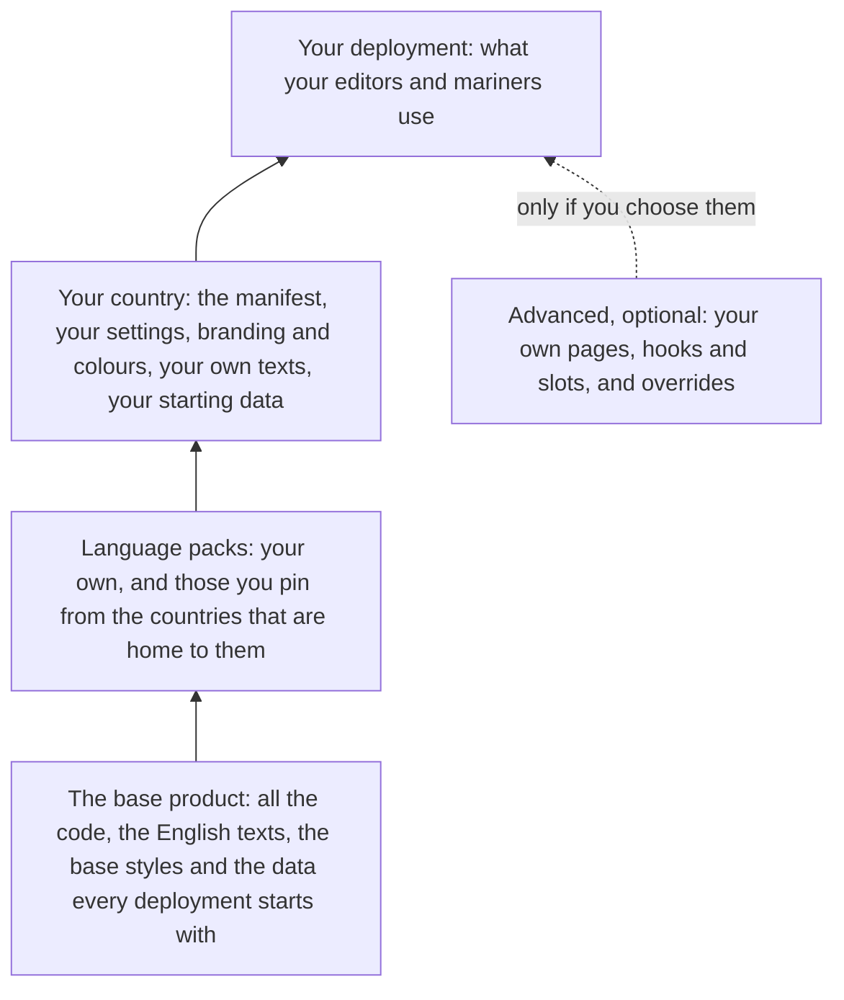
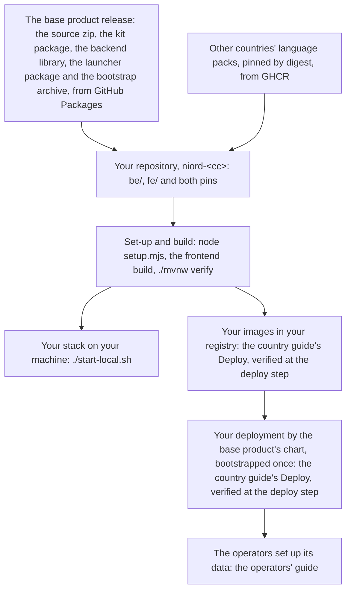

# The country guides

## The idea: one base product, and your country on top

Niord is a system for maritime safety information: navigational warnings and notices to mariners.
Editors write and publish messages in the administration app, mariners read them on the public site,
and a backend stores them and sends them out.

Every country that runs Niord needs the same system, with its own language, look, waters and
rules. So Niord comes in two parts:

- **The base product** is the system itself, the same for every country and knowing none of them.
  Its maintainers build it, fix it and publish it in numbered versions.
- **Your country** is a thin layer on top, in a repository of your own. It holds only what makes
  your deployment yours, and never a copy or an edit of the base product's code.

The point of the split is that improvements flow one way, to everyone. A fix, a security fix or a
new feature in the base product reaches your country when you move to the new version. Your
country's differences stay in your repository, so they survive every upgrade, and no other
country's choices end up in yours.

Your deployment is built from layers. Each lies over the one below it, and where two set the same
thing, the higher one wins:

How it is done:

- **One version, pinned.** Your repository names the one base product version it builds on, in
  `be/pom.xml` and in `fe/niord-pins.lock.json`. The lock also holds the checksums of the base
  product's source zip and of its kit package, so set-up builds on exactly what was published.
- **Set-up lays your country over the base.** `node setup.mjs` fetches that version, checks it,
  and puts your files in place at fixed points the base product offers for them (its seams). The
  backend works the same way: your country module is built on the base product's library.
- **What your country adds** is mostly settings and content: the manifest, your settings,
  branding and colours, your languages and texts, and your starting data (your domains, message
  series and templates). Code of your own (pages, hooks, slots) is possible, through the extension
  points the base product offers, but most countries need little or none of it.
- **Code and data stay apart.** The code arrives with the version you pin. Data, such as your
  templates, reports and domains, enters a deployment once, when it is first set up, and after
  that only when an operator imports it. Moving to a new version never changes a running
  deployment's data.
- **An upgrade is one pull request** in your own repository: you move the pin, run set-up, and do
  what its report lists.

The rest of this page says how far the guides go, which steps every country takes, how the parts
fit together, and which guide is for whom.

## About these guides

These guides tell you how to build and run a country of Niord on the base product. They ship in the
base product's kit package, `org.niord:niord-country-kit`. After `node setup.mjs` you read them at
`.niord/kit/docs/`, so they always match the version you build on.

The [kit README](../README.md) is the reference: the guides say who does what and in which order,
and link into it for the detail. [API-CHANGES.md](../API-CHANGES.md) records what each base version
changed for a country and what you must do about it.

**What the guides cover, and how far.** Local development is guided: the country guide's Quick
start and Make it yours take a country from an empty folder to both applications running on your
machine on your own bootstrap. The image push is not: its last step is a placeholder you write
yourself (the country guide's [Deploy](country-guide.md#deploy)). Staging and the operators'
guide's parts on a deployment are written but are verified only at the deploy step.

## What is mandatory, and what is optional

The country guides tag each of their sections, and the operators' guide each of the steps you take
in a running deployment, with one of three tags, in bold at the start of the line under the
heading. The country guide carries the first two; the Advanced parts are in the
[in-depth guide](country-guide-in-depth.md):

- **Mandatory.** Every country does it.
- **When it applies:** only a country that has the case does it, and the line says which case, such
  as "if you are home to a language".
- **Advanced (optional).** Most countries never need it, and each one you choose adds work to every
  upgrade
  ([Advanced, only if you choose them](responsibilities-and-upgrades.md#advanced-only-if-you-choose-them)).

Inside a section, a part that needs a case or a choice of its own starts with its tag and its name
in bold, such as "**When it applies: a font of your own.**", and then the case. A part with no tag
shares the section's tag.

Advanced features are optional. A country that does only the mandatory sections, and those that apply
to it, is a complete country: it builds, runs and goes live with no advanced part.

## How it fits together

Your country is your own repository, built on what the base product publishes:

## Who reads what

Read in this order. Everyone starts with the first guide.

| Who                              | Read                                                                                                                                                                                                                                                               |
| -------------------------------- | ------------------------------------------------------------------------------------------------------------------------------------------------------------------------------------------------------------------------------------------------------------------ |
| Everyone, first                  | [responsibilities-and-upgrades.md](responsibilities-and-upgrades.md): what the base product gives you, what you own, and how you move to a new base version                                                                                                        |
| People setting up a country      | [country-guide.md](country-guide.md): the standard path from an empty folder: the release, init's answers, set-up and the local run, then Make it yours and Deploy, with the definition of done and the checklist before go-live                                   |
| People who extend a country      | [country-guide-in-depth.md](country-guide-in-depth.md): what init wrote and why, the manifest field by field, languages, seams and own code, the backend beyond the standard, the build, the pipelines and the local run in detail                                 |
| Designers                        | [designers-brief.md](designers-brief.md): the brand tokens, the contrast floors, fonts, logos and icons, and a brief to paste into a design tool                                                                                                                   |
| An AI agent setting up a country | [set-up-prompt.md](set-up-prompt.md): the prompt a person gives an AI agent in an empty folder: what it never does, the prerequisites, init's questions, the release, init, set-up, the launcher and its three checks, and the first commit, never pushed          |
| An AI agent in a country         | [templates/AGENTS.md](../templates/AGENTS.md): the agent contract `init` writes as `AGENTS.md` at the root of a new country, with a one-line `CLAUDE.md` that imports it; a country with its own merges its sections by hand ([API-CHANGES.md](../API-CHANGES.md)) |
| Operators                        | [operators-guide.md](operators-guide.md): the data a new country sets up in the running system, from the administration app and Keycloak                                                                                                                           |
