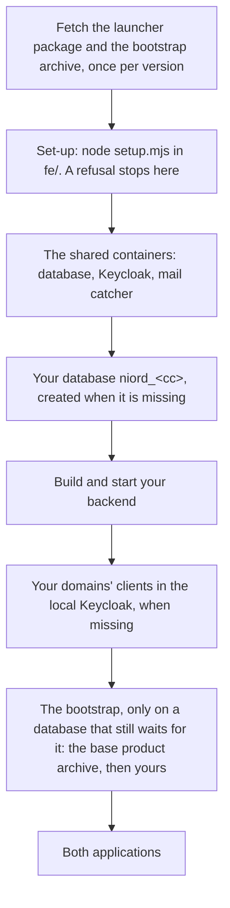

# The country guide in depth

For whoever wants to tinker with a country, or to know why it is as it is: what `init` wrote and
why, the manifest field by field, languages beyond the standard, seams and own code, the backend
beyond the standard, the backend build, the pipelines and the local run in detail.

The standard path, from an empty folder to both applications running and on to go-live, is the
[country guide](country-guide.md); start there. The reference is the [kit README](../README.md),
and the backend contract is `.niord/kit/docs/country-api.md`, which the kit carries.

Each section starts with one of three tags, in bold on the line under its heading:

- **Mandatory.** Every country does it.
- **When it applies:** only a country that has the case does it, and the line says which case.
- **Advanced (optional).** Most countries never need it, and each one you choose adds work to every
  upgrade
  ([Advanced, only if you choose them](responsibilities-and-upgrades.md#advanced-only-if-you-choose-them)).

Inside a section, a part that needs a case or a choice of its own starts with its tag and its name
in bold, such as "**When it applies: a font of your own.**", and then the case. A part with no tag
shares the section's tag. Advanced features are optional: a country that does only the mandatory
parts, and those that apply to it, is a complete country.

In this guide `<cc>` is your country's ISO 3166-1 alpha-2 code, two letters in lower case, and
`<Cc>` the same with a capital first letter. `<version>` is the base product version you build on,
`4.0.<n>`. The examples use a made-up country `qq`.

## What init wrote, file by file

**Mandatory.** Every country starts from what `init` wrote, and this section says why each part is
there. `init` writes 23 files from your answers: the backend `be/` whole, the manifest
`fe/niord-country.json`, the public site's configuration `fe/info/app/info.config.ts`,
`.github/CODEOWNERS`, the workflows `.github/workflows/image.yml` and `.github/workflows/ci.yml`,
and the root `README.md`. Beside them it writes the skeleton every country shares: `start-local.sh`,
the set-up stub `fe/setup.mjs`, the branding files, the brand tokens, `.gitignore` and
`.gitattributes` at the root and in `fe/`, the workflows `pack.yml` and `base-bump.yml`,
`.github/dependabot.yml`, `pack-releases.md`, `AGENTS.md`, `CLAUDE.md` and the pins
`fe/niord-pins.lock.json`. It never writes over a file that exists: such a file is kept, and `init`
lists it as `kept`. An existing `be/pom.xml` is kept too, and its parent must name the kit's
version, or `init` refuses and writes nothing.

At its root your repository then has:

| Path             | What                                                                                      |
| ---------------- | ----------------------------------------------------------------------------------------- |
| `be/`            | the backend: your deployable, built on the base product's library; `init` writes it whole |
| `fe/`            | the frontend: your manifest, packs, branding, seams and code                              |
| `.github/`       | your owners and your workflows; `init` writes them                                        |
| `start-local.sh` | the local launcher; `init` writes it, and every bump copies the kit's template over it    |
| `.niord/`        | the release's two zips, their two lines and the kit unzipped; never committed             |

### The backend

**`be/pom.xml`.** Your deployable's Maven project, from the kit's template
`.niord/kit/templates/be/pom.xml.tmpl`, with your code and the base version filled in. Its comments
say what each part is for. Why each part is there:

- **The `<parent>`** version is the pin of the whole repository: set-up, the launcher and the image
  job all read it here, and the Base bump workflow moves it.
- **The `<artifactId>`**, `niord-<cc>`, is the deployable's name, the jar's name and the `MODULE`
  of `image.yml`. The pom has no `<version>`: it inherits the parent's.
- **The `github` repository** is here, not in the parent, because Maven resolves the parent with
  the child's repositories.
- **The properties:** `artemis.version`, because the Spring Boot BOM's older Artemis fails to start
  on Java 25; `testcontainers-keycloak.version`, because nothing manages that library and without
  its version the pom fails `validate`; and `maven.deploy.skip`, since a country ships an image,
  never a jar.
- **The dependencies** that name no version take it from Spring Boot's dependency management,
  which `niord-parent` inherits. `niord-base` is the library. Its test-jar is the base product's
  country checks, the country build group ([The backend build](#the-backend-build)). A test-jar
  brings no dependencies of its own, so the tests' libraries are declared here, `rest-assured` with
  its version. Both Testcontainers libraries exclude `io.quarkus:quarkus-junit4-mock`.
- **The plugin** `spring-boot-maven-plugin` needs no configuration: Spring Boot's parent, which
  `niord-parent` inherits, configures its repackage.
- **When it applies: the packs' copies.** For each language you answered, two executions of
  `maven-resources-plugin`, `copy-<lang>-pack-backend` and `copy-<lang>-pack-flag`, and one
  `<available>` line, the flag's, in the `require-staged-packs` check. Every pack archive carries
  its flag, and a copy from a folder that does not exist copies nothing, so a pack with no backend
  half still builds, and a build before set-up is still refused. Add the backend half's
  `<available>` line once you know the pack has that half
  ([The backend build](../README.md#the-backend-build)).

The pom holds no unpack of the bootstrap archive for integration tests of your own
([Integration tests of your own](#integration-tests-of-your-own)) and no mirror of GRAD's library
([GRAD's SECOM library, mirrored for now](#grads-secom-library-mirrored-for-now)).

**The Maven wrapper:** `be/mvnw`, `be/mvnw.cmd` and `be/.mvn/wrapper/maven-wrapper.properties`,
which `init` copied from the kit's `.niord/kit/backend/mvnw`, `.niord/kit/backend/mvnw.cmd` and
`.niord/kit/backend/maven-wrapper.properties`: the same as the base product's, wrapper 3.3.4 with
Maven 3.9.16. `be/mvnw` has LF line ends and mode 0755, `be/mvnw.cmd` CRLF. You need no Maven
install: the first run of `be/mvnw` fetches Maven itself into `~/.m2/wrapper/`.

**`be/.gitignore`:** `target/` and `.flattened-pom.xml`. The build writes `target/`, and
`niord-parent`'s flatten plugin writes `.flattened-pom.xml` beside your pom. Neither is committed.

**`be/.java-version`:** `25`.

**`be/.gitattributes`:** `mvnw text eol=lf` and `mvnw.cmd text eol=crlf`, because `mvnw` breaks
when it is checked out with CRLF; and `bootstrap/** text=auto eol=lf`, because your bootstrap is
zipped as checked out and its templates are compared byte for byte.

**`be/src/main/java/org/niord/<cc>/Niord<Cc>Application.java`:** the Spring Boot application, in
the package `org.niord.<cc>`. A code that is a Java keyword gets `<cc>_`, such as `org.niord.do_`.
It scans the whole of `org.niord`, so the base product's beans and yours start together:

```java
package org.niord.qq;

import org.springframework.boot.SpringApplication;
import org.springframework.boot.autoconfigure.SpringBootApplication;
import org.springframework.boot.persistence.autoconfigure.EntityScan;
import org.springframework.scheduling.annotation.EnableAsync;
import org.springframework.scheduling.annotation.EnableScheduling;

/** The QQ deployment of the Niord backend. */
@SpringBootApplication(scanBasePackages = "org.niord")
@EntityScan("org.niord")
@EnableScheduling
@EnableAsync
public class NiordQqApplication {
    public static void main(String[] args) {
        SpringApplication.run(NiordQqApplication.class, args);
    }
}
```

**`be/src/main/resources/application.yml`:** your configuration, and only yours. Without its
comments, `init` writes:

```yaml
spring:
  application:
    name: niord-qq
niord:
  s124:
    enabled: true
```

`niord.s124.enabled` is `true` in every country `init` writes. When you answered a producer code,
`init` adds `producer-code: <your code>` under `enabled`.

**When it applies: if you publish S-124.** `niord.s124.producer-code` is your own IHO S-62 producer
code: exactly four upper-case letters or digits. The base product leaves it unset. Without it the
backend still starts, but it generates no S-124 data, and the backend's public S-124 interface
answers every request for a message with an error until a code is set. A value of any other form
stops the backend at its start. `init` checks the form of the code you answer, but nothing checks a
code written later before the backend starts: not `validate`, set-up or the frontend build. With
SECOM switched on, the backend does not start without a code. Leave it empty until your authority
has its own code: `init` refuses the guides' placeholder and another authority's code.
[Before go-live](country-guide.md#before-go-live) asks for the real one, or S-124 turned off
([Turning S-124 off](#turning-s-124-off)).

Three rules hold for every configuration file in your jar: no `spring.security.*` key but
`spring.security.oauth2.resourceserver.jwt.issuer-uri`; no actuator or CORS settings; and never a
`@PropertySource` on a class. The start-up guard refuses each.

**`be/src/main/resources/application-local.yml`:** the `local` profile. Without its comments:

```yaml
server:
  address: 127.0.0.1

spring:
  datasource:
    url: jdbc:postgresql://localhost:5432/niord_qq
    username: niord
    password: niord
  mail:
    host: localhost
    port: 1025
  jpa:
    properties:
      jakarta.persistence.validation.mode: none
  security:
    oauth2:
      resourceserver:
        jwt:
          issuer-uri: http://localhost:8080/auth/realms/niord

niord:
  smtp:
    host: localhost
    port: 1025
```

It names the local realm's issuer, the local database with its user and password, and the local
mail catcher on port 1025, both for Spring's mail and for Niord's own `niord.smtp`. The launcher
passes its own database URL, port and Niord home, so the URL here serves only a backend you start
by hand. The profile sets no `server.port`, because the launcher passes `-Dserver.port=<BE_PORT>`;
a backend you start by hand passes `-Dserver.port=8888` itself, since Spring's default, 8080, is the
local Keycloak's
([The backend's time zone and a start by hand](#the-backends-time-zone-and-a-start-by-hand)).
The JPA property is here because the base product's defaults do not set it:
`jakarta.persistence.validation.mode: none`, as the base product's own `local` profile sets it, so
the backend does not enforce bean-validation constraints when it saves an entity. The base
product's defaults already batch the loading of lazy collections and references
(`hibernate.default_batch_fetch_size`: one statement loads them for up to 256 owners, such as the
messages of a list), in every profile, so a country's configuration does not set it. A copy in a
profile of yours, such as one at 16 from before the base product set it, wins over that value in
every run that loads the profile: delete it.

**`be/overrides.json`:** `{ "overrides": [] }`, until you override a static image, such as your
logo in the PDFs ([Your logo in the PDFs](country-guide.md#your-logo-in-the-pdfs)).

The settings file and the bootstrap have sections of their own, below.

### The settings file

`be/src/main/resources/defaults/country/settings.json`, with a short `README.md` beside it saying
what the folder holds. It replaces the base product's settings file whole, so it answers for every
key of that file. `init` generated it from the kit's copy of the base product's file,
`.niord/kit/backend/defaults/base/settings.json`, and its catalog,
`.niord/kit/backend/defaults/base/settings-catalog.json`, which gives each key's type, scope and
description:

- `values` holds the 11 keys your answers set: `country` (your code in upper case),
  `organisation`, `niord.home` (`${NIORD_HOME}`), `defaultLanguage` (`en`), `modelLanguages`,
  `siteLanguages` and `infoSiteLanguages` (English and then your languages), `infoDefaultLanguage`
  (`en`), and `mapDefaultLatitude`, `mapDefaultLongitude` and `mapDefaultZoomLevel` (your map
  centre and zoom).
- `useBaseDefault` lists each of the other 15 keys of the base product's file with the reason the
  base product's default is right for a new country: `mode`, `baseUri`, `adminAppUrl`,
  `authServerUrl`, `documentationUrl`, `editorFieldsBase`, `editorFieldsNw`, `editorFieldsNm`,
  `stdTemplateFields`, `wmsLayerEnabled`, `openSeaMapLayerEnabled`, `osmUrl`, `openSeaMapUrl`,
  `mapTileContact` and `disableLucene`.

For `qq`, the start of the file:

```json
{
  "values": {
    "country": "QQ",
    "organisation": "Qualia Maritime Authority",
    "niord.home": "${NIORD_HOME}",
    "defaultLanguage": "en",
    "modelLanguages": ["en"],
    "siteLanguages": ["en"],
    "infoSiteLanguages": ["en"],
    "infoDefaultLanguage": "en",
    "mapDefaultLatitude": 50,
    "mapDefaultLongitude": -20,
    "mapDefaultZoomLevel": 6
  },
  "useBaseDefault": [
    {
      "key": "mapTileContact",
      "reason": "empty until the deployment names its contact for the tile servers (before go-live)"
    }
  ]
}
```

When a later base version adds a key to its file, set it in `values` or list it in
`useBaseDefault` with a reason: the build's settings check names it until you do. The rules the
check holds the file to:

- Every key of the base product's file is either set in `values` or listed in `useBaseDefault`
  with a reason. The base product's file of your version is
  `.niord/kit/backend/defaults/base/settings.json`, and the build's settings check names each key
  you have neither set nor listed.
- A value has its key's type, which `.niord/kit/backend/defaults/base/settings-catalog.json`
  gives. An `Integer` key, such as `mapDefaultLatitude`, takes a whole number (`57`, not `57.2`), a
  `Boolean` key `true` or `false`, a `String` key a text, and a `json` key a value of the shape the
  base product's file gives it.
- `country` (the same ISO 3166-1 alpha-2 code as `<cc>`, in upper case) and `organisation` are
  required, and cannot be listed in `useBaseDefault`.
- The languages match the manifest: `siteLanguages`, `modelLanguages`, `defaultLanguage`,
  `infoSiteLanguages` and `infoDefaultLanguage`. Set-up compares them.
- `"niord.home": "${NIORD_HOME}"`. Without it the base product's `${user.home}/.niord` wins over
  `NIORD_HOME`, and the server writes its index, files and archives outside the folder you meant.
- No secret. A password setting stays empty here; the real value is set on the Settings page.
- Your own settings are declared in your code, with keys in your namespace (`<cc>.…`).
- Every value is a default: start-up adds a key a deployment lacks and never changes one it has.

How to see it worked: after a local start, `.local-run/backend.log` holds
`Default setting niord.home = ${NIORD_HOME} (country)`.

### The bootstrap

`be/bootstrap/`: your data for a fresh deployment. It is data, not code: it never goes into
`src/main/resources`, the jar or the image. `init` wrote the smallest bootstrap, one domain with one
series, from your answers:

- `be/bootstrap/README.md`, which starts "Data, not code. …" and says what the folder holds;
- `be/bootstrap/batch-set.json`, a list of items, each a job's name and the file it reads:

```json
[{ "jobName": "domain-import", "fileName": "domains.json" }]
```

- `be/bootstrap/domains.json`, a list of domains, here the one you answered:

```json
[
  {
    "domainId": "qq-nw",
    "name": "Qualia Navigational Warnings",
    "active": true,
    "publish": true,
    "sortOrder": 1,
    "timeZone": "Europe/London",
    "lat": 50,
    "lon": -20,
    "zoomLevel": 6,
    "messageSeries": [
      {
        "seriesId": "qq-nw",
        "mainType": "NW",
        "shortFormat": "QQ-NW-${number-3-digits}-${year-2-digits}",
        "numberSequenceType": "YEARLY"
      }
    ]
  }
]
```

The fields:

- A domain: `domainId`, which is also its Keycloak client's ID; `name`; `active`; `publish`, so the
  public site shows its messages; `sortOrder`; `timeZone`, the IANA zone of the waters it covers;
  and `messageSeries`. It may also give `lat`, `lon` and `zoomLevel` (the map's centre), `color`,
  `messageSortOrder`, and `atons` and `templates` (`true` or `false`), the fields of Sysadmin >
  Domains.
- A series: `seriesId`; `mainType`, `NW` or `NM`; `numberSequenceType`, `YEARLY`, `CONTINUOUS`,
  `MANUAL` or `NONE`; and `shortFormat`, the message's number as text. Its tokens include
  `${number}`, `${number-3-digits}`, `${year}`, `${year-2-digits}`, `${week}`, `${week-2-digits}`,
  `${main-type}` and `${country}` (the settings file's `country`). A warning series may give
  `navtexFormat`, its NAVTEX preamble.
- The domain import adds a domain the database lacks and leaves one it has alone.

The base product's own domain, `niord-client-master`, is active, with no message
series: a sysadmin reaches the Sysadmin pages on it even before your domain's Keycloak client
exists. To leave it inactive, restate it in your `domains.json` with its `domainId` and
`"active": false` and nothing else; a restatement that gives any other field, or any other domain
an earlier archive gave, is refused. At least one domain of yours has `"active": true`.

More data than one domain is in [More bootstrap data](#more-bootstrap-data).

### The group check

`be/scripts/check-country-build-group.sh` proves that the country build group ran, and your CI runs
it after `./mvnw verify` ([The backend build](#the-backend-build)). A run in which the group found
no test, or Docker was missing, is green without it. It checks three things:

- `target/failsafe-reports/failsafe-summary-niord-country-build.xml` reports `completed` above 0;
- its `skipped` is below `completed` (Failsafe counts a skipped test as completed);
- a Surefire report of `CountryContractGuardTest` exists under `target/surefire-reports/`.

`init` wrote it as the kit's template holds it:

```bash
#!/usr/bin/env bash
# Fails unless the country build group ran in the last ./mvnw verify.
set -euo pipefail
cd "$(dirname "${BASH_SOURCE[0]}")/.."
summary=target/failsafe-reports/failsafe-summary-niord-country-build.xml
[[ -f "$summary" ]] || { echo "the country build group's integration tests did not run"; exit 1; }
completed=$(sed -n 's|.*<completed>\([0-9]*\)</completed>.*|\1|p' "$summary" | head -1)
skipped=$(sed -n 's|.*<skipped>\([0-9]*\)</skipped>.*|\1|p' "$summary" | head -1)
[[ "${completed:-0}" -gt 0 ]] || { echo "the country build group ran no integration test"; exit 1; }
[[ "${skipped:-0}" -lt "$completed" ]] ||
  { echo "every test of the group skipped: is Docker running?"; exit 1; }
compgen -G 'target/surefire-reports/TEST-*CountryContractGuardTest.xml' >/dev/null ||
  { echo "CountryContractGuardTest did not run"; exit 1; }
echo "the country build group ran: $completed integration tests, $skipped skipped"
```

### GRAD's SECOM library, mirrored for now

The base product's backend needs GRAD's SECOM library, `org.grad.secom:secom-v2-core-jakarta`
0.1.0, and its parent pom `secom-v2-parent` 0.1.0, which only GRAD's repository hosts.
`niord-parent` declares that repository, so your pom names nothing for it, and `init` writes no
mirror. When that repository is down, a build without a warm Maven cache fails before it compiles.
The owner's ruling of 2026-11-01 keeps the countries' file mirror for now: a country may carry the
library in its own repository, as the existing countries do
([The backend's SECOM library](responsibilities-and-upgrades.md#the-backends-secom-library)).

**When it applies: a mirror of your own.** If your builds must not depend on GRAD's repository,
copy the library from a Maven cache that has it, such as `~/.m2/repository` on a machine whose
build passed:

1. From `~/.m2/repository/org/grad/secom/secom-v2-core-jakarta/0.1.0/`, copy exactly
   `secom-v2-core-jakarta-0.1.0.jar`, `secom-v2-core-jakarta-0.1.0.jar.sha1`,
   `secom-v2-core-jakarta-0.1.0.pom` and `secom-v2-core-jakarta-0.1.0.pom.sha1` into
   `be/third-party-maven/org/grad/secom/secom-v2-core-jakarta/0.1.0/`.
2. From `~/.m2/repository/org/grad/secom/secom-v2-parent/0.1.0/`, copy exactly
   `secom-v2-parent-0.1.0.pom` and `secom-v2-parent-0.1.0.pom.sha1` into
   `be/third-party-maven/org/grad/secom/secom-v2-parent/0.1.0/`.
3. Copy nothing else: never a `_remote.repositories` or a `*.lastUpdated` file.
4. Add `be/third-party-maven/.gitattributes` holding `* -text`, so the files keep their bytes on
   every checkout, and a `be/third-party-maven/README.md` saying what the folder is and how to
   remove it: delete the folder and the repository below.
5. List the folder first in `be/pom.xml`'s `<repositories>`, before `github`:

```xml
<repository>
  <id>grad-mirror</id>
  <name>GRAD's SECOM library, mirrored in this repository</name>
  <url>file://${project.basedir}/third-party-maven</url>
  <snapshots><enabled>false</enabled></snapshots>
  <releases><enabled>true</enabled></releases>
</repository>
```

The build then takes the two artifacts from the folder whether or not GRAD's repository answers.
Each `.sha1` file is the checksum GRAD published for its file.

### The frontend and the repository

- **`fe/setup.mjs`** is the set-up stub, byte for byte the kit's `.niord/kit/templates/setup.mjs`.
  Never edit it: the compatibility promise covers it, and every bump copies the new one over it
  ([The compatibility promise](responsibilities-and-upgrades.md#the-compatibility-promise)).
- **`fe/niord-country.json`**, the manifest
  ([The manifest, field by field](#the-manifest-field-by-field)).
- **`fe/info/app/info.config.ts`**, the public site's configuration, with the time zone you
  answered ([The public site's configuration](#the-public-sites-configuration)).
- **The branding files** the branding schema requires, the base product's defaults, in English;
  and **the brand tokens** `fe/styles/tokens.<cc>.css`, a copy of the default's
  ([Make it yours](country-guide.md#make-it-yours)).
- **`.gitignore` and `.gitattributes`** at the root and in `fe/`. `fe/.gitignore` names what
  set-up generates, `fe/.niord/` among it, and the root `.gitignore` names `.local-run/`, the
  launcher's downloads and logs: `init` appends that line to a root `.gitignore` that exists, or
  writes the file. `.niord/` at the root ignores itself through the `.gitignore`, holding `*`,
  that `init` writes into it. Both `.gitattributes` store every text file with LF, and the root's
  keeps `start-local.sh`, the workflows and `AGENTS.md` LF on a Windows checkout too, so a
  country's CI may compare the launcher with the template byte for byte; Windows command scripts
  keep CRLF.
- **`.github/CODEOWNERS`** with the owners you answered.
- **The workflows** ([The pipelines in detail](#the-pipelines-in-detail)).
- **`AGENTS.md`** at the root, the agent contract for an AI agent that works in your repository,
  and **`CLAUDE.md`** beside it, which holds only `@AGENTS.md` and so loads it in Claude Code
  ([Who reads what](README.md#who-reads-what)).
- **The pins**, `fe/niord-pins.lock.json`: the source zip's and the kit's hashes, which set-up
  checks every package against.

`init` gives `start-local.sh`, `be/mvnw` and `be/scripts/check-country-build-group.sh` mode 0755.
On Linux and macOS, `git add -A` records the mode. Git on Windows records a new file without its
exec bit, and CI on Linux then cannot run it, so on Windows the first commit takes `init`'s line,
from the repository root:

```bash
git add -A && git add --chmod=+x start-local.sh be/mvnw be/scripts/check-country-build-group.sh
```

For a checkout that lost an exec bit later, `git update-index --chmod=+x <file>` gives it back.
`git ls-files -s be/mvnw` then starts with `100755`.

The first `npm run build` in `fe/` ends green with one warning: no bundle baseline yet.
[The checks on every country build](../README.md#the-checks-on-every-country-build) says how to
start one.

`init` writes no `fe/country/`, no `fe/text-overrides/` and no `fe/audit-accepted.json`: each is
yours to add once you need it.

## The manifest, field by field

**Mandatory.** `init` wrote `fe/niord-country.json` from your answers: your code as `country`, your
name as `name`, each application's `uiLanguages` (and the administration app's `contentLanguages`)
English first and then the languages you answered, `defaultLanguage` `en`, every answered language
pinned in `packs`, `locales` `{}` and `overrides` `[]`. Change it when your languages change.

`name` is your country's name, in plain text of at most 60 characters: the launcher prints it when
the stack is up. Each application has the languages it offers (`uiLanguages`; the administration
app's `contentLanguages` too; `defaultLanguage`). The manifest says which packs you are home to and
which you pin from another home, a `locale` per language where it differs from the pack's, and your
overrides (normally `[]`; overrides are advanced, [Guarded overrides](#guarded-overrides)). Every
language but English has a `packs` entry: `{ "home": true, "publish": <boolean> }` for your own,
`{ "pinned": true }` for another home's, with `owner` when that pack's GitHub owner is not the
default. The fields and their rules are in
[The manifest](../README.md#the-manifest--feniord-countryjson).

After a change, in `fe/`:

```bash
node setup.mjs
```

How to see it worked: set-up passes and prints the UI languages it stages, one line per
application: `setup: staged admin: <lang>, …; …` and `setup: staged info: …`. A pinned pack without
a pin, or a pack of your own without its folder, fails here with a message that says so
([Languages](#languages)).

## The base product's backend files

**When it applies:** if you translate the backend's texts, or need another file of the base
product's backend.

The kit carries the backend files the standard path needs: the base product's settings file and
its catalog at `.niord/kit/backend/defaults/base/settings.json` and
`.niord/kit/backend/defaults/base/settings-catalog.json`, the PDF logo at
`.niord/kit/backend/img/company-logo.png`, and the backend contract at
`.niord/kit/docs/country-api.md`. The kit does not carry the English of the backend's texts,
`defaults/base/texts/en/<bundle>.properties`, which a pack's backend half translates
([Languages](#languages)), nor any other file of the niord-base jar. For those, fetch the jar into
a folder of its own, from the repository root:

```bash
be/mvnw -B -f be/pom.xml dependency:copy \
  -Dartifact=org.niord.base:niord-base:<version> -DoutputDirectory="$PWD/.local-run/<version>/read"
(cd .local-run/<version>/read &&
  unzip -q -o niord-base-<version>.jar 'defaults/base/*' 'defaults/base/texts/en/*')
```

In `.local-run/<version>/read/` you then find `defaults/base/texts/en/<bundle>.properties`, the
English of the backend's five bundles, beside the settings file and its catalog. Name any other
file of the jar in the `unzip` line the same way.

Read the backend contract, `.niord/kit/docs/country-api.md`, with the protected beans and
properties, the country build group, the bootstrap rules and the override check, before you change
the backend beyond what `init` wrote. Where it cites a document of the base product's own
repository, which you do not get, the rule it states is the rule.

The root `.gitignore` keeps `.local-run/` out of git, and the launcher does not use this folder. At
a bump of the base product, fetch the new version's files the same way.

## Languages

**When it applies:** if you offer a language other than English, which is the base product's own.
Each such language is either yours or another country's, and each has its part below. A language
you answered to `init` is pinned from its home, and `init` wrote its backend copies; a language you
add later, or one you are home to, follows the parts below.

### A language that is yours

**When it applies:** a language you are home to. It lives in `fe/packs/<lang>/`. Start it as a
content language: the manifest's `contentLanguages` and a `packs` entry
`{ "home": true, "publish": false }`. It needs:

- `pack.json` with exactly four fields: `lang`, `label` (the language's name in itself, at most 40
  plain characters), `locale` and `flag` (`img/flags/<lang>.png`);
- the flag `img/flags/<lang>.png`, a PNG of at most 64 KB; the packs share one size, 64×64 with the
  flag at 60×40 from (2,12);
- its drawing `img/flags/<lang>.svg`, and `ATTRIBUTION.txt` with the drawing's sources and its
  render command. The English pack's `fe/.niord/base/languages/en/ATTRIBUTION.txt` is the model.

To offer it as a UI language, add `i18n/admin/<lang>.json` and `i18n/info/<lang>.json`, with
`status/unaccepted.json` and `status/fingerprints.json`, and name it in `uiLanguages`. A text a
reader of the language has not accepted is listed in `unaccepted.json`. Accepting is that reader's
act, with `node ../.niord/kit/pack.mjs accept`. Add `backend/<bundle>.properties` for the
backend's texts: the keys of a bundle are in `.niord/base/catalog.json`, and their English is the
niord-base jar's `defaults/base/texts/en/<bundle>.properties`
([The base product's backend files](#the-base-products-backend-files)). All of it is in
[Language packs](../README.md#language-packs), under "A language no pack has yet".

### A language another country is home to

**When it applies:** a language another country publishes. It is pinned. Name it
`{ "pinned": true }` in the manifest (`init` did so for each language you answered), then write its
pin, in `fe/`:

```bash
node setup.mjs --update-pins
```

Before you commit a first pin, compare the digest it wrote with the one the home's
`pack-releases.md`, at the root of its repository, records: for `da`, the one in
`SIFA-DK/niord-dk`, a repository that is not public yet; when you cannot read the home's
repository, its maintainers give you the line. Every later move of the pin is a reviewed pull
request ([Pinning a pack](../README.md#pinning-a-pack)). When a home withdraws the tag you pin,
set-up fails with the reason until you move the pin
([Withdrawing a pack](../README.md#withdrawing-a-pack)).

### The backend half

**When it applies:** every pack but English. For each language you answered, `init` already wrote
both copies and the flag's `<available>` line into `be/pom.xml`
([The backend](#the-backend)). For a language you add later, add the pack's two copies and its
`<available>` lines to `be/pom.xml` by hand, in the same change that adds the pack to the manifest:
the pair of lines for a pack with a backend half, and the flag's line only for a content language
without one. Set-up stages the pack's backend half and flag into `fe/.niord/packs/<lang>/`, and the
copies take them into the jar ([The backend build](../README.md#the-backend-build)).

### The escape hatch

**Advanced (optional).** When a pinned pack lacks a key the base product added, list the key in
`fe/missing-keys-accepted.json`: `{ lang, app, bundle (backend only), key, reason, added }`, each
with a reason. Staging fills it from English. Keep the list short
([Language packs](../README.md#language-packs)).

### Publishing a pack you are home to

**When it applies:** if other countries are to pin a pack of yours. Set `"publish": true`.
`pack.yml`, which `init` wrote, publishes the pack on the first push to `main` that changes its
folder. Then make the GHCR package public once, so other countries can pin it
([Publishing a pack](../README.md#publishing-a-pack)).

How to see it worked: `node setup.mjs` passes its pack check. For each pack,
`fe/.niord/packs/<lang>/img/flags/<lang>.png` exists, and `fe/.niord/packs/<lang>/backend/` too
once the pack has a backend half. A content language without one gives one warning per backend
bundle: the default language serves its texts.

### A default language other than English

**When it applies:** if your applications' default language is not English. `init` always writes
`en` as the default. Another default needs, in the same change:

- the manifest's `defaultLanguage`, per application
  ([The manifest, field by field](#the-manifest-field-by-field));
- the settings file's `defaultLanguage` and `infoDefaultLanguage`
  ([The settings file](#the-settings-file));
- the public site's index page seam, whose `lang` is the default language and whose title is that
  language's `SITE_TITLE` from its pack
  ([The public site's index page](#the-public-sites-index-page)).

The build holds the page to both, as one of
[the checks on every country build](../README.md#the-checks-on-every-country-build). A deployment
that already runs keeps its stored default until an operator changes it
([Recipe: add a language](#recipe-add-a-language), its last part).

### Recipe: add a language

**When it applies:** if you add a language other than English. For a language you are home to:

1. A pack of your own as a content language: `fe/packs/<lang>/` with `pack.json`'s four fields,
   the flag PNG, its SVG drawing and `ATTRIBUTION.txt`; the language in `contentLanguages` and a
   `packs` entry `{ "home": true, "publish": false }` ([Languages](#languages)).
2. Its backend half: `backend/<bundle>.properties`, translated from the English the niord-base jar
   holds ([The base product's backend files](#the-base-products-backend-files)), the pom's two
   copies and its pair of `<available>` lines ([The backend half](#the-backend-half)), and the
   language in the settings file's `modelLanguages` ([The settings file](#the-settings-file)).
3. **When it applies: its UI texts.** If you offer it as a UI language: `i18n/admin/<lang>.json`
   and `i18n/info/<lang>.json`, with `status/unaccepted.json` and `status/fingerprints.json`, and
   the language in `uiLanguages` and in the settings file's `siteLanguages` (administration app) or
   `infoSiteLanguages` (public site) ([Languages](#languages),
   [The settings file](#the-settings-file)).
4. **When it applies: its branding.** If you offer it as a UI language: `branding/<lang>.json` and
   the legal documents in that language, for each application that offers it
   ([Make it yours](country-guide.md#make-it-yours)).
5. **When it applies: publishing it.** If other countries will pin it: `"publish": true`, and
   `pack.yml` publishes it on the merge
   ([Publishing a pack you are home to](#publishing-a-pack-you-are-home-to)).
6. **When it applies: running deployments.** For each deployment that already runs, once the
   version with the language is deployed, hand it to the operators (below).

**When it applies: a language another country is home to.** A `{ "pinned": true }` entry and
`node setup.mjs --update-pins`
([A language another country is home to](#a-language-another-country-is-home-to)), then steps 3, 4
and 6 above.

`node setup.mjs` after each change says what is still missing.

**When it applies: turning it on in a running deployment.** The settings file is only a default:
start-up adds a key the database lacks and never changes one it has
([The settings file](#the-settings-file)). A new database takes the languages from your settings
file. A deployment that already has its settings keeps its old languages, and the new one stays off
in both applications, until an operator changes the stored values on Sysadmin > Settings, with the
pencil:

- `modelLanguages`, a JSON list such as `["en", "zz"]`: the message languages, a field each in the
  editor;
- `siteLanguages`, a JSON list: the administration app's UI languages. A language the build ships
  no UI bundle for is left out;
- `infoSiteLanguages`, a JSON list: the public site's languages, again only those the build ships;
- `defaultLanguage`, a text such as `zz`, only when the new language becomes the default. It must
  be one of `modelLanguages`; otherwise the first of them is used;
- `infoDefaultLanguage`, a text, only when the new language becomes the public site's default. It
  must be one of the public site's languages; otherwise the first of them is used.

Then reload both applications: each reads its languages when it loads. For the two text keys,
`defaultLanguage` and `infoDefaultLanguage`, a value the server is given at its start wins over the
page ([step 15 of the operators' guide](operators-guide.md#15-settings)). The three lists are JSON,
and both applications read the value the page shows. The operators' own steps are in
[A new language in a running deployment](operators-guide.md#a-new-language-in-a-running-deployment).

How to see it worked: `curl http://localhost:4200/rest/settings/web` on a local run, or
`/rest/settings/web` on the deployment, shows the new values. The administration app's language
menu in its header lists the language, and the editor shows a field for it. The public site's menu
offers it beside its other languages.

## Seams and own code

**Mandatory.** Every country has the public site's configuration, which `init` wrote, and lists its
own addresses, the first parts below. Change only what your country does differently: the parts
tagged otherwise are for some countries only. A seam is a file at a fixed path that replaces a
neutral base product file ([The seams](../README.md#the-seams--seamsjson)).

### The public site's configuration

`fe/info/app/info.config.ts` is a seam. `init` wrote it with the four fields `InfoConfig` requires
and the time zone you answered:

```ts
import type { InfoConfig } from '@niord/info/api';

/**
 * The public site's configuration: the clock in the time zone of the country's waters, no area
 * filter (the message views query the whole data set) and the base product's default footer.
 */
export const COUNTRY_INFO: InfoConfig = {
  timeZone: 'Europe/London',
  executionMode: 'production',
  wmsLayer: false,
  rootAreas: [],
};
```

Before go-live, add `backendHosts` and `accessibilityStatement`
([Before go-live](country-guide.md#before-go-live)). The other fields, `footerComponent` among
them, are in `.niord/base/ui-apps/info/src/app/niord-info.config.ts`. Without the file, the public
site uses the base product's default
(`.niord/base/ui-apps/info/src/app/country-specific/default/info.config.ts`), on UTC.

### The public site's time zone

**When it applies:** if you change the zone you answered, or your domains span zones.

The public site shows every time, such as a message's dates and the footer's year, in the
`timeZone` of `fe/info/app/info.config.ts`, which `init` wrote from your answer; the base product's
default is UTC. It never reads a domain's time zone. `init` wrote the same answer as the time zone
of your first domain, in `be/bootstrap/domains.json`. Keep `timeZone` the IANA zone of your waters,
the zone your domains use, such as `timeZone: 'Europe/London'`. The administration app shows times
in the zone of the domain chosen in its menu, and the PDFs the public site offers are printed by
the backend in the zone of the messages' domain. The public site's pages and its PDFs agree only
when the two zones match. If your domains span zones, pick the one your readers expect.

How to see it worked: after `node setup.mjs` and a start, a published message's times on the public
site read in your zone, the same wall clock as the administration app shows with that message's
domain chosen in its menu. Pick a message whose date your zone puts off UTC, such as one in summer
time, to see the difference.

### Your own absolute addresses

**Mandatory.** Your own absolute addresses, such as your authority's site or your accessibility
statement, go in `fe/build-urls-allowed.json`, each with a reason and scoped with `app` (`"info"`
or `"admin"`) to the application that links it. Never a font or a stylesheet
([The checks on every country build](../README.md#the-checks-on-every-country-build)). The check
reads the built scripts, styles and pages: an address that only a branding file or a legal document
carries needs no entry, and a country with no address in its code writes no file.

### The administration app's environments

**When it applies:** if a build needs values other than the base product's, such as a map WMS or
the map's opening view. Write the seam `admin/environments/environment.<configuration>.ts`. Each
has `production: true` for a deployed build and same-origin addresses (`apiBaseUrl`,
`keycloak.url` and `map.wmsUrl` each start with a single `/`).

### The public site's index page

**When it applies:** if the public site's default language is not English, or a text override
rewords `SITE_TITLE` in that language. Write the seam `info/app/index.html`. The build holds the
page's `lang` to the default language and its title to that language's `SITE_TITLE`
([A default language other than English](#a-default-language-other-than-english)).

### Your own footer

**Advanced (optional).** Only for more than the default footer offers. The public site's default
footer shows the copyright line and offers each legal document whose label your branding sets
([Legal documents](country-guide.md#legal-documents)). A footer of your own replaces it: name your
component as `footerComponent` in `fe/info/app/info.config.ts`, and open each legal document with
`openInfoDialog` and `loadLegalDialog` from `@niord/info/api`, with its id (`disclaimer`,
`cookies`). The example country's [footer](../example/fe/info/app/footer/footer.component.ts) opens
only the disclaimer, with `{ documentId: 'disclaimer' }`; the cookie statement opens the same way
with `cookies`. A footer of your own offers the link to the accessibility statement itself too.

### End-to-end specs of your own

**Advanced (optional).** They go in `fe/e2e/`. The lint keeps a spec to four imports:
`@niord/admin/e2e`, `@playwright/test`, `node:` built-ins and files of `e2e/`
([End-to-end specs](../README.md#end-to-end-specs)).

### Pages, menu entries, hooks and slots

**Advanced (optional).** Your own pages, menu entries, hooks and slots go through the country API
only ([The extension points](../README.md#the-extension-points),
[The country API](../README.md#the-country-api)). Need one that does not exist? Ask the base
product for it.

### Guarded overrides

**Advanced (optional).** Only where no extension point fits:
`node setup.mjs --add-override <base file> --reason <text>`. Each one is a cost at every upgrade
([Guarded overrides](../README.md#guarded-overrides)).

### Text overrides

**Advanced (optional).** Your own wording of a base product text goes in
`fe/text-overrides/<lang>.json` ([Text overrides](../README.md#text-overrides)).

### Your own npm packages

**Advanced (optional).** Only in `fe/country/package.json`, each with its application and a reason.
Make the lock with `node setup.mjs --update-country-lock`
([Country dependencies](../README.md#country-dependencies)).

The [example country](../README.md#the-example-country) uses every extension point once. Read its
files for the shape of each. After a change, in `fe/`:

```bash
node setup.mjs
npm test
npm run lint
npm run build
```

How to see it worked: all four are green. Your pages and slot components appear in the running
applications.

## Turning S-124 off

**When it applies:** a country not ready for S-124. Set `enabled` to `false` in
`be/src/main/resources/application.yml`:

```yaml
niord:
  s124:
    enabled: false
```

The backend's S-124 interface, `/rest/S-124/**`, is then not mapped and answers 404, and the
producer code is neither used nor checked. SECOM needs S-124: the backend refuses to start with
`niord.secom.enabled` on and `niord.s124.enabled` off, naming both keys. The automatic cancellation
warning stays as it is, whatever the switch says. Turning S-124 on later is the same line set back
to `true`, with your producer code
([The backend](#the-backend)).

## The backend module beyond the standard

**When it applies:** each part below names its case. The whole backend contract, with the protected
beans and properties, the country build group, the bootstrap rules and the override check, is
`.niord/kit/docs/country-api.md`, which the kit carries. Read it before you change the backend
beyond what `init` wrote.

### Your texts

**When it applies:** if a template or the Java code reads a text of yours. They go in
`be/src/main/resources/defaults/country/texts/<lang>/<bundle>.properties` (the bundles `web`,
`message`, `pdf`, `mail` and `template`), and they are only your own keys, prefixed `<cc>.`, and
your own wording of a base product key. A rewording only the administration app shows is a
frontend [text override](#text-overrides) or branding ([Texts](country-guide.md#texts)).

### More bootstrap data

**When it applies:** more data than the one domain `init` wrote.

- `batch-set.json` names each job and its file, in the runner's job order: `script-resource-import`
  (the folder `templates`), `domain-import`, `dictionary-import`, `category-import`,
  `param-type-import`, `mailing-list-import`, `report-import` and `promulgation-type-import`, then
  `chart-import`, `area-import`, `source-import`, `publication-category-import` and
  `publication-import`. Name only the jobs you have a file for. No item carries `add` or
  `overwrite`, and the bootstrap takes no settings and no messages.
- `domains.json` holds your domains, each with its message series and its time zone
  ([The bootstrap](#the-bootstrap)).

The base product's bootstrap is applied first, in the same run, and then yours. Within that run:

- a value your archive gives replaces the base product's, and a value the base product left empty
  is filled;
- a value you leave out keeps the base product's, an empty text counts as left out, and a list you
  give, even an empty one, replaces the base product's list (template parameters, domain links and
  a report's properties are merged instead);
- what is new is added (a language, a domain link, a dictionary entry), and nothing is removed.

An upload is limited to 50 MB a part and 50 MB a request, niord-base's defaults, which match the
body limit of the chart's proxy. A deployment whose archive is larger raises Spring's
`spring.servlet.multipart.max-file-size` and `max-request-size`, and its proxy's body limit with
them.

### Release folders

**When it applies:** once a release adds or changes a template, script or report. Its import files
go in `be/bootstrap/releases/<yyyy-mm-dd>-<topic>/` (a template as `script-resources.json`, the
Script resources import's format), with the folder's own `README.md`. A sysadmin imports one into
each deployment after its preview. Nothing in it arrives by itself, and a folder never changes once
merged. Every one of these folders' READMEs starts with the same words as `be/bootstrap/README.md`:
"Data, not code. …". Put no README directly in `releases/`: the archive accepts only files inside a
release's folder there.

### Template paths

**When it applies:** if your bootstrap or a release folder has localized templates. List their
paths in `be/src/main/resources/META-INF/niord/expected-template-paths.txt`, one a line. The
missing-path report uses the list only for a localized variant (`x_<ll>.ftl`) of a template that
data or code already names (`x.ftl`): such a variant is reported when no row holds it. A listed
path that is no such variant, or whose `x.ftl` nothing names, is never reported.

### Your own footer template in the PDFs

**When it applies:** instead of the logo override. The message-list PDFs, those the public site
offers among them, print `/img/company-logo.png` in their footer, from the base product's template
`templates/messages/message-list-pdf-footer.ftl`. The standard way to put your logo there is to
override the image ([Your logo in the PDFs](country-guide.md#your-logo-in-the-pdfs)). The other way
is your own `be/bootstrap/templates/messages/message-list-pdf-footer.ftl`, through
`script-resource-import` of the folder `templates` in your `batch-set.json`, naming an image of
your own at a path the base product does not use, such as `/img/company-logo-<cc>.png` from
`be/src/main/resources/META-INF/resources/img/`. Your bootstrap's copy replaces the base product's
in the same run, and no override is needed.

### Other image overrides

**Advanced (optional).** The only base product file you may replace is a static image (png, jpg,
jpeg, gif, webp or ico) under `META-INF/resources/img/`. List any other image you override in
`be/overrides.json` the same way as the logo
([Your logo in the PDFs](country-guide.md#your-logo-in-the-pdfs)). Any other shadow of a base
product file fails the override check.

### Integration tests of your own

**Advanced (optional).** A bootstrap integration test of your own needs an unpack of
`org.niord:niord-bootstrap:${project.version}:zip` into `target/niord-bootstrap/` at
`pre-integration-test`, after a clean of that folder, in `be/pom.xml`. For one integration test
class of your own, in `be/`:

```bash
./mvnw verify -Dit.test=<Class> -Dtest=_none_ -Dsurefire.failIfNoSpecifiedTests=false
```

## The backend build

**Mandatory.** Set-up runs before every Maven build of your backend: on your machine, in CI and in
the image job. It stages the packs your pom copies into `fe/.niord/packs/`. The pom's check refuses
a build before set-up with
`fe/.niord/packs/ lacks a pack this build copies: run node fe/setup.mjs first`
([The backend build](../README.md#the-backend-build)). The copies land in `be/target/classes/`,
the backend halves in `defaults/packs/<lang>/` and the flags in `META-INF/resources/img/flags/`,
so the jar carries them.

With Docker running, from the repository root:

```bash
(cd fe && node setup.mjs)
(cd be && ./mvnw verify && scripts/check-country-build-group.sh)
```

On Windows, export the Niord home first, as init's last line says,
`export NIORD_HOME=$(cygpath -m "$TEMP")/niord`; either kind of slash works in the path. The
folder is shared by every Niord build on the machine, so two `verify` runs must not overlap.

The country build group's integration tests need Docker. A run whose integration tests skipped
still ends with `BUILD SUCCESS`, with `Tests run: 0`, so always run the group check afterwards
([The group check](#the-group-check)). For one integration test class of your own, see
[Integration tests of your own](#integration-tests-of-your-own).

How to see it worked: the jar `be/target/niord-<cc>-<version>.jar` is built, and the group check
prints its counts, with more than 0 integration tests and fewer skipped than completed.

## The pipelines in detail

**Mandatory.** Every country builds, tests and ships with these pipelines. `init` wrote each of
them; every run block in them starts with `set -euo pipefail`, and the workflow token is bound only
to the steps that run Maven.

### The CI workflow

`.github/workflows/ci.yml`, from the kit's `.niord/kit/templates/ci.yml`. It runs on every pull
request into `main`, on a push to `main` that changed `be/**`, `fe/**` or `.github/workflows/**`
(Markdown under `be/` and `fe/` is left out), and on `workflow_dispatch`. Two jobs run beside each
other:

- **tests**: check out; JDK 25 with GitHub Packages' credentials (server id `github`); the Maven
  cache; Node 24 and set-up, before Maven; `./mvnw verify` in `be/`, the unit tests and the
  integration suite; the override check over the packaged jar against `be/overrides.json`; the
  group check; the test reports.
- **frontend**: in `fe/`, set-up, `npm ci`, `npm test`, `npm run lint`, the end-to-end specs listed
  (`npm run e2e -- --list`) and `npm run build`.

Its `on:` takes `workflow_dispatch:` because the Base bump workflow dispatches CI on the commit it
pushes: a push with that workflow's token starts no workflow. A `ci.yml` that existed before `init`
ran is kept, and `init` prints a notice when it lacks that trigger. When a later kit changes the
template, the upgrade report lists it under To look at, as a merge into
`.github/workflows/ci.yml`: what to adopt is your call
([The upgrade report](../README.md#the-upgrade-report)).

### The image workflow

`.github/workflows/image.yml`, as `init` wrote it, has three jobs:

- **frontend**, with no secret beyond the workflow's token: set-up, `npm ci`, the specs, the lint,
  the build, and the public site's image built and checked in a browser.
- **backend**, with no secret beyond the workflow's token: set-up before Maven, the jar, the
  override check over it, and the split the image is built from.
- **push**, in the `harbor` environment and on `main` only: it verifies the three artifacts by their
  SHA-256 and the version, then pushes. Its last step is a placeholder that fails until you write
  the step that builds and pushes your administration bundle's image.

Set `REGISTRY` and `HARBOR_PROJECT` in its `env`; `init` filled `MODULE` with your pom's
artifactId. While one is empty, the job that needs it fails with a message. It runs on demand; add
the trigger you build on, such as a green CI run of a push to `main`
([image:info](../README.md#the-public-site-image--imageinfo)).

### The pack workflow

**When it applies:** if you are home to a language. `.github/workflows/pack.yml` validates,
publishes and withdraws your home packs
([Publishing a pack you are home to](#publishing-a-pack-you-are-home-to)).

### The Base bump workflow

`.github/workflows/base-bump.yml`, as `init` wrote it, carries each base bump. When the Niord base
bump app is installed on your repository
([Install the Niord base bump app](responsibilities-and-upgrades.md#install-the-niord-base-bump-app)),
the bump is its pull request on a `base-bump/<version>` branch, opened minutes after each release
and moved to each newer one; without it, and whenever you want one, it is a pull request you open
from a `base-bump/<version>` branch. The workflow checks release `v<version>`'s notes against the
two downloads, and only then pins the lock, sets the workspace up, copies the stub and the launcher,
moves every pinned pack to its home's newest pack in the same pull request, commits, dispatches CI
and posts one comment with the upgrade report and `## Human actions`. A move posts the comment
again, and a box keeps its tick when the thing it is about is unchanged: its text, and for a
template its content in the kit. The status `niord/upgrade-actions` stays
red while a box of that comment is unticked. You do the report's To do and each item, tick each
box, then review, merge and deploy. The workflow reads the release notes of the public base
product's repository with your repository's own token, and needs no secret.
[How an upgrade works today](responsibilities-and-upgrades.md#how-an-upgrade-works-today) gives the
steps, and [The base bump workflow](../README.md#the-base-bump-workflow) the detail.

### Dependabot

`.github/dependabot.yml` asks for security updates only, of `fe/country/` and of the workflows'
actions. The base product version and the pinned packs' digests come with the base bump
([The Base bump workflow](#the-base-bump-workflow)). A `.github/renovate.json` an older `init` wrote
is inert: delete it, or keep it
([Install the Niord base bump app](responsibilities-and-upgrades.md#install-the-niord-base-bump-app)).

How to see it worked:

- `ci.yml` is green on a pull request, and its `on:` has `workflow_dispatch:`.
- The first base bump pull request shows the Base bump comment and the check
  `niord/upgrade-actions`: verified at the first bump.
- Run `image.yml` from the Actions tab once `REGISTRY` and `HARBOR_PROJECT` are set: its frontend
  and backend jobs are green.
- The push itself: verified at the deploy step.

## Running locally in detail

**Mandatory.** `./start-local.sh`, from the repository root, runs your country on your machine. The
detail is in [Running it locally](../README.md#running-it-locally--start-localsh).

### What the launcher does

The launcher first fetches the base product's launcher package and bootstrap archive, once per
version. Then it runs set-up, starts the shared containers (database, Keycloak and a mail catcher),
creates your database, builds and starts your backend, gives each active domain of
`be/bootstrap/domains.json` its client in the local Keycloak when it is missing, bootstraps the
database once, and starts both applications.



### The first bootstrap

The plain run bootstraps `niord_<cc>` once: the base product's archive, then `be/bootstrap/`, whose
`batch-set.json` and `domains.json` `init` wrote, so the first start brings your domain. A run on a
fresh database after `be/bootstrap/batch-set.json` was deleted by hand bootstraps the base
product's archive alone, and the database is never bootstrapped again: stop the launcher, drop the
database with `docker exec niord-db dropdb -U niord niord_<cc>`, and start it again.

A run whose backend did not start, such as on a configuration value it refused at start-up, posted
no bootstrap. The launcher made and marked the database, and the backend may have given it its
tables, but it still waits for its bootstrap: fix the cause and start the launcher again, with no
`dropdb`. That run prints `Bootstrapping database niord_<cc>`. Only a bootstrap that was posted
spends the database.

### Your sysadmin in your own domain

**Mandatory.** The administration app grants a role from the client of the domain chosen in its
menu, and from `niord-client-master` in every domain. The local realm's group `Sysadmin` holds
`sysadmin` on `niord-client-master`, so the local `sysadmin` reaches the Editor, Admin and Sysadmin
areas in your domain before its client exists. A role on your domain's client is still needed where
the app reads that client alone: the pencil beside the domain in the menu's domain list, and the
domain pickers of a firing schedule, which offer only the domains whose clients the user holds a
role on. At every start, the launcher creates in the shared local realm `niord` the missing client of each domain of
`be/bootstrap/domains.json` with `"active": true`. The client's ID is the domain's `domainId`, and
it is bearer-only, like the realm's other domain clients. It holds the roles `user`, `editor`,
`admin`, `sysadmin` and `publication-curate`: `editor` holds `user`; `admin` holds `editor` and
`publication-curate`; `sysadmin` holds `editor`, `admin` and `publication-curate`. The group
`Sysadmin` is given `sysadmin` and `publication-curate`.

The launcher never updates or deletes anything in Keycloak: a client that exists is left exactly as
it is, and a second start adds nothing. You see one `>> Creating the local Keycloak client <id>`
line per new client, or a line ending `exist: left as they are`. A failure is a `!!` line naming
what failed; the start goes on, `docker logs niord-keycloak` says why, and the next
`./start-local.sh` tries again. Only the local `sysadmin` is given a role: give the groups of
admins and editors theirs in Keycloak's admin console when you need them. A session signed in
before the client was made needs a new sign-in.

**When it applies: by hand, as the fallback.** A client the launcher left with roles missing is
never repaired by it. Delete the client in Keycloak's admin console at
`http://localhost:8080/auth/admin/` (`admin` / `admin`), realm `niord`, Clients, and start the
launcher again: it creates the client whole.

Without a browser, the same client can be made through the container's own `kcadm.sh`, in the
order the launcher makes it (an AI agent or a script takes this form; in Git Bash,
`MSYS_NO_PATHCONV=1` keeps the container path from being rewritten):

```bash
export MSYS_NO_PATHCONV=1
K="docker exec niord-keycloak /opt/keycloak/bin/kcadm.sh"
$K config credentials --server http://localhost:8080/auth --realm master --user admin --password admin
$K create clients -r niord -s clientId=<domainId> -s enabled=true -s bearerOnly=true \
  -s publicClient=false -s protocol=openid-connect -s standardFlowEnabled=true \
  -s directAccessGrantsEnabled=true -s fullScopeAllowed=false
CID=$($K get clients -r niord -q clientId=<domainId> --fields id --format csv --noquotes)
for role in user editor admin sysadmin publication-curate; do
  $K create clients/$CID/roles -r niord -s name=$role
done
rid() { $K get clients/$CID/roles/$1 -r niord --fields id --format csv --noquotes; }
$K add-roles -r niord --rid "$(rid editor)" --cclientid <domainId> --rolename user
$K add-roles -r niord --rid "$(rid admin)" --cclientid <domainId> \
  --rolename editor --rolename publication-curate
$K add-roles -r niord --rid "$(rid sysadmin)" --cclientid <domainId> \
  --rolename editor --rolename admin --rolename publication-curate
$K add-roles -r niord --gname Sysadmin --cclientid <domainId> \
  --rolename sysadmin --rolename publication-curate
```

The realm lives in the shared container's volume, so the client stays for every later run on this
machine. The realm also holds clients and groups that are not yours, such as those of the base
product's sample: leave them alone. Keycloak's sign-in page may open in another language than
English: its language list switches it.

### Another database, the sample and the ports

- The plain run is your own bootstrap, the base product's archive and then yours, on the database
  `niord_<cc>` ([The databases](../README.md#the-databases)).
- `./start-local.sh --sample` runs the base product's sample deployment instead, on
  `niord_sample_<cc>`, with your settings and texts.
- **When it applies: another database.** If `niord_<cc>` already holds other local data on your
  machines, commit a `start-local.json`, `{ "database": "<name>" }`, naming another database. The
  launcher refuses a database it did not make.
- The ports are 4200 (administration app), 4400 (public site) and 8888 (backend). Pick others with
  `FE_PORT`, `INFO_PORT` and `BE_PORT`.
- Each database has its own Niord home, `~/.niord-local/<database>`.

### The backend's time zone and a start by hand

**The backend's JVM runs in UTC.** Times without a zone are stored and read in the JVM's zone, so a
JVM on a zone with summer time shifts them by an hour in the repeated autumn hour. Your domains'
time zones decide what the administration app and the backend's texts and PDFs show; the public
site's pages use the `timeZone` of its `info.config.ts`
([The public site's time zone](#the-public-sites-time-zone)). The launcher passes
`-Duser.timezone=UTC`. A backend you start any other way passes it too, and the port, since the
local profile sets none ([The backend](#the-backend)). After set-up:

```bash
cd be
NIORD_HOME=<a folder of your own> ./mvnw spring-boot:run -Dspring-boot.run.profiles=local \
  -Dspring-boot.run.jvmArguments="-Duser.timezone=UTC -Dserver.port=8888"
```

Never edit `start-local.sh`. At every bump of the base product, after set-up, copy the kit's
template over it again from the repository root:

```bash
cp .niord/kit/templates/start-local.sh start-local.sh
```

### A development server's port on Windows

The launcher refuses a port that is in use before it starts anything, naming its variable, such as
`Port 4200 is already in use — pick another with FE_PORT=<port> ./start-local.sh`. Ctrl+C in the
launcher stops the backend and both applications and frees its three ports; the shared containers
keep running.

The development servers you start yourself, `npm run start:admin` and `npm run start:info` in
`fe/`, each run until Ctrl+C in their own terminal. On Windows, a server whose npm ended any other
way, such as a killed task, can keep its port. Find its process with
`netstat -ano | grep ':4200 .*LISTENING'` (or `:4400`), the last column, and stop it with
`taskkill //PID <pid> //T //F`; Git Bash needs the double slashes. Then start the launcher or the
server again.

## Before go-live, beyond the standard

**When it applies:** each item below names its case. The standard checklist is
[Before go-live](country-guide.md#before-go-live); a deployment goes live only when it holds, and
these items too where they apply:

- [ ] **Advanced (optional): the escape hatch.** If you keep one, `fe/missing-keys-accepted.json`
      is reviewed.
- [ ] **Advanced (optional): guarded overrides and other image overrides.** Each one is reviewed
      against the base version you go live on, with its reason.
- [ ] **When it applies: environments of your own.** Each
      `admin/environments/environment.<configuration>.ts` of a deployed build has
      `production: true`
      ([The administration app's environments](#the-administration-apps-environments)).
- [ ] **When it applies: packs you are home to.** Each pack's `status/unaccepted.json` is empty.
- [ ] **Advanced (optional): your own footer.** It offers the legal documents and the
      accessibility statement's link.

## Definition of done for an extended country

**When it applies:** a country with parts beyond the standard. The standard list is
[Definition of done for a country](country-guide.md#definition-of-done-for-a-country); beyond it,
every item that applies holds:

- [ ] **Advanced (optional): guarded overrides.** Every one has its reason, and no base product
      code changed but through one.
- [ ] **Advanced (optional): your own promulgation services.** Each resolves, with its renderer and
      editor.
- [ ] **Advanced (optional): end-to-end specs of your own.** They pass with `npm run e2e` in `fe/`.
- [ ] **Advanced (optional): your own npm packages.** They are locked with
      `node setup.mjs --update-country-lock`.
- [ ] **Advanced (optional): text overrides and the escape hatch.** Their entries are kept short,
      each with its reason.
