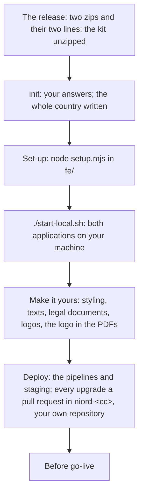

# The country guide

For the person who starts a country of Niord: its first maintainer. For most countries this guide
is all they need: step by step, it takes you from an empty folder to your country running on your
machine, made your own and ready for its deployment. The [Quick start](#quick-start) and
[Make it yours](#make-it-yours) take you to both applications running on your machine on your own
bootstrap. In [Deploy](#deploy), the image push ends in a placeholder step that you write, and
staging is written but verified only at the deploy step.



Read [responsibilities-and-upgrades.md](responsibilities-and-upgrades.md) first: it says what the
base product gives you and what you own. For whoever wants to tinker, or to know why, the reference
is the [in-depth guide](country-guide-in-depth.md) and the [kit README](../README.md). Each section
starts with one of two tags, in bold on the line under its heading:

- **Mandatory.** Every country does it.
- **When it applies:** only a country that has the case does it, and the line says which case.

A part that needs a case of its own starts with its tag and its name in bold, such as "**When it
applies: a font of your own.**"; a part with no tag shares its section's. Every part tagged
**Advanced (optional)** is in the [in-depth guide](country-guide-in-depth.md): most countries never
need one, and each one adds work to every upgrade
([Advanced, only if you choose them](responsibilities-and-upgrades.md#advanced-only-if-you-choose-them)).
A country that does the mandatory sections and those that apply to it is a complete country.

`<cc>` is your country's ISO 3166-1 alpha-2 code, two letters in lower case, and `<CC>` the same in
upper case. `<version>` is the base product version you build on, `4.0.<n>`. The examples use a
made-up country `qq`.

## Quick start

**Mandatory.** From an empty folder to both applications running on your machine.

### What you need

- A JDK 25 with `jar`, and `JAVA_HOME` exported naming it in every shell you build in: set-up runs
  `be/mvnw`, which reads it. The launcher also finds a JDK in `~/.jdks/temurin-25`; set-up does not.
- Node `^22.22.3 || ^24.15.0 || ^26.0.0`, as the base product names it, and npm 11.11.0 or a later
  11.x: use Node 24, 24.15.0 or later, with its npm 11. Check with `node --version` and
  `npm --version`. Neither set-up nor the launcher checks npm's version (the `fe/package.json` that
  set-up writes names 11.11.0 as its `packageManager`), and npm only warns, with `EBADENGINE`, about
  a Node outside the range.
- Docker, running (Docker Desktop on Windows); `curl`, `git`, `unzip` and `sha256sum`, which Git
  Bash has; and the GitHub CLI `gh`, signed in to your GitHub account.
- On Windows, Git Bash. Paths without spaces ([Prerequisites](../README.md#prerequisites)). No
  Maven install and no `be/pom.xml`: init writes the backend with its Maven wrapper.

### The token

Maven reads the base product from GitHub Packages, which refuses an unauthenticated read even of a
public package: you need the token also once the base product's repository is public. Make a classic
personal access token of your GitHub account with the `read:packages` scope, and put it in
`~/.m2/settings.xml` (on Windows the `.m2` folder in your user folder, where Maven reads it):

```xml
<settings>
  <servers>
    <server>
      <id>github</id>
      <username><your GitHub user name></username>
      <password><your token></password>
    </server>
  </servers>
</settings>
```

Replace both placeholders, angle brackets included; in a file that exists, add the `<server>` to its
`<servers>`. Set-up, the backend build and the launcher all read it. Never commit it.

### The release

Make the repository in an empty folder; then, from its root, fetch the release's two zips, the
source zip and the kit package, check them against their two lines, and unzip the kit. Never copy
another country's `be/` or `.github/` into it: init keeps every file that exists, so a copied
`.github/` keeps the other country's workflows instead of this version's.

```bash
mkdir niord-<cc> && cd niord-<cc> && git init
mkdir .niord
gh release download v<version> --repo NiordOrg/niord4 \
  --pattern 'niord-fe-src-<version>.zip' --pattern 'niord-country-kit-<version>.zip' --dir .niord
printf '%s\n' '<fe-sha256>  niord-fe-src-<version>.zip' \
  '<kit-sha256>  niord-country-kit-<version>.zip' > .niord/SHA256SUMS
(cd .niord && sha256sum -c SHA256SUMS)
unzip -q .niord/niord-country-kit-<version>.zip -d .niord/kit
```

The two lines come exactly as the notes of release `v<version>` give them
(`gh release view v<version> --repo NiordOrg/niord4`); release notes exist from 4.0.182. Run
nothing from either zip before both say `OK`. Only the kit is unzipped: init reads the source zip in
memory from `.niord/`, and
writes `.niord/.gitignore`, holding `*`, so nothing of `.niord/` is committed. The unzip writes no
marker, so the first `node setup.mjs` fetches both packages once more through `be/mvnw`, with your
token, and marks them.

### The answers

init asks 16 questions, one line each; it works in Git Bash on Windows. A value in [brackets] is the
standard default, taken with Enter alone.

| Question (its key)          | What it means                                                                                                                                                                                   | Standard default                                              |
| --------------------------- | ----------------------------------------------------------------------------------------------------------------------------------------------------------------------------------------------- | ------------------------------------------------------------- |
| `country`                   | the ISO 3166-1 alpha-2 code in lower case, two letters; it names `niord-<cc>`, `org.niord.<cc>` and `niord_<cc>`: choose it once                                                                | required                                                      |
| `name`                      | the name the applications show, plain text, at most 60 characters                                                                                                                               | required                                                      |
| `organisation`              | the authority that runs the deployment, plain text, at most 100 characters                                                                                                                      | required                                                      |
| `languages`                 | languages besides English, separated by spaces, each a published pack pinned from its home; each becomes a UI and content language of both applications                                         | none (English only)                                           |
| `producerCode`              | **When it applies: if you publish S-124.** Your IHO S-62 producer code, four upper-case letters or digits; leave it empty until your authority has its own                                      | none                                                          |
| `timeZone`                  | the IANA zone of your first domain and the public site, spelt as the tz database spells it: `UTC`, or Area/Location with capitals such as `Europe/London`; a wrong case is refused              | required                                                      |
| `map.lat`                   | the map's centre: latitude, whole degrees from -90 to 90                                                                                                                                        | required                                                      |
| `map.lon`                   | longitude, whole degrees from -180 to 180                                                                                                                                                       | required                                                      |
| `map.zoom`                  | zoom level, 1 to 18                                                                                                                                                                             | `6`                                                           |
| `domain.mainType`           | `NW` (navigational warnings) or `NM` (notices to mariners)                                                                                                                                      | `NW`                                                          |
| `domain.id`                 | the first domain's id and its Keycloak client's id: lower-case letters, digits and `-`, starting with a letter, 2 to 63 characters; not `niord-client-master` nor a Keycloak built-in client id | `<cc>-nw` (`<cc>-nm` for NM)                                  |
| `domain.name`               | plain text, at most 100 characters                                                                                                                                                              | `<name> Navigational Warnings` (`<name> Notices to Mariners`) |
| `series.id`                 | the first message series' id, by the domain id's rule                                                                                                                                           | `<cc>-nw` (`<cc>-nm`)                                         |
| `series.shortFormat`        | a message's number as text, with the backend's tokens such as `${number-3-digits}` and `${year-2-digits}`; a number token unless the numbering is `NONE`                                        | `<CC>-NW-${number-3-digits}-${year-2-digits}` (`-NM-` for NM) |
| `series.numberSequenceType` | `YEARLY`, `CONTINUOUS`, `MANUAL` or `NONE`                                                                                                                                                      | `YEARLY`                                                      |
| `owners`                    | the repository's owners for `.github/CODEOWNERS`, each `@user` or `@org/team`, separated by spaces                                                                                              | required                                                      |

Each language is a pack another country publishes on GHCR as `ghcr.io/<owner>/niord-lang-<lang>`,
each tag with its digest, which the summary of the home's Pack run that published it states too.
When this kit was released, `da` was the one published pack: `ghcr.io/sifa-dk/niord-lang-da`, whose
home is `SIFA-DK/niord-dk`. For a pack that is not published and public, set-up's `--update-pins`
writes no pin and says so, with `an anonymous pull needs the package to be public` or
`is the package public?`; see
[A language another country is home to](country-guide-in-depth.md#a-language-another-country-is-home-to).

init refuses another authority's producer code and the guides' placeholder, and writes
`niord.s124.enabled: true` with or without a code. After the last answer it prints the answers as
JSON (`init: the answers, as --answers takes them:`). A refusal names every problem at once and
writes nothing: save the printed answers as `.niord/init-answers.json`, correct them, and run init
again with `--answers` (below). That file is in `.niord/`, so it is never committed.

### Init, set-up and the launcher

From the repository root:

```bash
node .niord/kit/init.mjs <cc> --sha256-file .niord/SHA256SUMS
(cd fe && node setup.mjs)
./start-local.sh
```

The `<cc>` answers the first question, so 15 follow. With the answers in a file, init's line is
`node .niord/kit/init.mjs --answers .niord/init-answers.json --sha256-file .niord/SHA256SUMS`. When
you named languages, set-up's is `(cd fe && node setup.mjs --update-pins)`: it writes their pins.

init checks both zips against the two lines before the first question, then writes about 40 files,
never over one that exists, prints `init: wrote <file>` for each, and ends with the next two
commands and the link to install the Niord base bump app ([Upgrades](#upgrades)). The launcher
fetches the launcher package and the bootstrap archive once per version, runs set-up and `npm ci`,
starts the shared containers (database, Keycloak, mail catcher), creates `niord_<cc>`, builds and
starts your backend, gives each active domain of `be/bootstrap/domains.json` its client in the local
Keycloak when it is missing, bootstraps the database once with the base product's archive and then
yours, and starts both applications. The first run builds the backend and takes some minutes.
The launcher gives the backend its Niord home, `~/.niord-local/<database>`: a cache that is made
again when it is missing, and the batch jobs' files. A backend you start another way needs
`NIORD_HOME` set to a folder, or its start is refused with `niord.home cannot be resolved` and how
to set it.
`./start-local.sh --sample` runs the base product's sample instead. The detail is in
[Running locally in detail](country-guide-in-depth.md#running-locally-in-detail) and
[Running it locally](../README.md#running-it-locally--start-localsh).

### How to see it worked

- init listed every file as `init: wrote <file>` and none as `kept`.
- The launcher printed `>> Creating the local Keycloak client <cc>-nw` (your domain's id) on its
  first start, and its closing lines list each address, the logins and the three logs.
- In the administration app on port 4200, log in as `sysadmin` / `sysadmin` and choose your domain
  in the menu: Editor, Admin and Sysadmin appear. A session signed in before the client existed needs
  a new sign-in.
- `curl http://localhost:4200/rest/settings/web` shows your languages;
  `curl http://localhost:4200/rest/domains/all` lists your domain.
- The public site on port 4400 shows times in the zone you answered, which init wrote into
  `fe/info/app/info.config.ts`
  ([The public site's time zone](country-guide-in-depth.md#the-public-sites-time-zone)).
- Ctrl+C stops the backend and both applications and frees the ports 4200, 4400 and 8888; the shared
  containers keep running. Pick other ports with `FE_PORT`, `INFO_PORT` and `BE_PORT`.

### When it goes wrong on Windows

- **A port still held.** A development server whose npm ended another way, such as a killed task,
  keeps its port, and the launcher refuses it:
  `Port 4200 is already in use — pick another with FE_PORT=<port> ./start-local.sh`. Find the
  process with `netstat -ano | grep ':4200 .*LISTENING'` (or `:4400`), the last column, and stop it
  with `taskkill //PID <pid> //T //F`; Git Bash needs the double slashes
  ([A development server's port on Windows](country-guide-in-depth.md#a-development-servers-port-on-windows)).
- **`The JAVA_HOME environment variable is not defined correctly`.** `be/mvnw` says so when
  `JAVA_HOME` names no JDK: export it naming your JDK 25.

### Commit

On Windows, Git records a new file without its exec bit, and CI on Linux then cannot run it, so the
first commit gives the three scripts theirs with init's line, and then `git commit`:

```bash
git add -A && git add --chmod=+x start-local.sh be/mvnw be/scripts/check-country-build-group.sh
```

On Linux and macOS `git add -A` keeps the modes init gave. Either way `git ls-files -s be/mvnw`
starts with `100755`. Nothing of `.niord/`, `fe/.niord/` or `.local-run/` is committed: their
`.gitignore` files keep them out.

### With an AI agent

An AI agent can do this Quick start with the kit's [set-up prompt](set-up-prompt.md): it asks you
each answer, never handles your token, and ends with the stack running and a first commit, which
you push. For later work, the `AGENTS.md` init wrote is the agent contract; `CLAUDE.md` beside it
holds only `@AGENTS.md` ([Who reads what](README.md#who-reads-what)).

### Log lines that are harmless

- Until fixed, `.local-run/backend.log` holds, twice per request,
  `ERROR … DomainService : Failed loading Keycloak states for domains` with an
  `IllegalStateException` stack trace, `User not authenticated`, when the sign-in page or the public
  site reads the domains without a sign-in.
- On the public site's first load in the development server, the console warns of a missing
  translation for `SITE_TITLE`, while the tab's title is right.

## Make it yours

**Mandatory.** Every country brands both applications as its own authority's.

### Styling

Your brand tokens are in `fe/styles/tokens.<cc>.css`, which init copied from the default. The rules
and the contrast floors are in the [designers' brief](designers-brief.md): hand it to your designer.
**When it applies: a font of your own.** It goes in `fe/styles/fonts.<cc>.css` with its files
([Fonts](designers-brief.md#fonts)); without one, the default's system stack stays.

### Texts

Your branding texts, such as the public site's copyright line `FOOTER_COPYRIGHT`, go per application
in `fe/admin/assets/branding/en.json` and `fe/info/assets/branding/en.json`
([Branding](../README.md#branding--brandingschemajson) lists the keys). Once an application has a
branding text, every UI language of it needs its `branding/<lang>.json`, and
`fe/admin/branding-unaccepted.json` and `fe/info/branding-unaccepted.json` list, per UI language,
what a reader of the language has not accepted yet: a value as `assets/branding/<lang>.json#<key>`,
a document as `assets/legal/<doc>.<lang>.html`. Your own wording of a base product text is a text
override, an advanced part ([Text overrides](country-guide-in-depth.md#text-overrides)).

### Legal documents

Each application's legal documents are `legal/<doc>.<lang>.html` in its `assets/` folder. The public
site's cookie statement, `legal/cookies.<lang>.html`, names every key the site stores in a reader's
browser, as `.niord/base/ui-apps/info/src/app/core/services/preference-keys.json` lists them. The
administration app's footer offers its documents by itself. The public site's default footer shows
the copyright line, and beside it each item whose label your branding sets:

| Label                  | What it offers                                                                                   | It also needs                                                           |
| ---------------------- | ------------------------------------------------------------------------------------------------ | ----------------------------------------------------------------------- |
| `FOOTER_DISCLAIMER`    | the disclaimer, in the legal dialog                                                              | `LEGAL_TITLE_DISCLAIMER` and `legal/disclaimer.<lang>.html`             |
| `FOOTER_COOKIES`       | the cookie statement, in the legal dialog                                                        | `LEGAL_TITLE_COOKIES` and `legal/cookies.<lang>.html`                   |
| `FOOTER_ACCESSIBILITY` | a link to your accessibility statement                                                           | its address as `accessibilityStatement` in `fe/info/app/info.config.ts` |
| `FOOTER_LOGO`          | your logo, `assets/branding/logo-gray.png` or `logo-gray-<lang>.png`, 44 px high, drawn at 22 px | `FOOTER_LOGO_ALT`, its alternative text                                 |

With no label set, it shows the copyright line only. A footer of your own is only for more than this
([Your own footer](country-guide-in-depth.md#your-own-footer)).

The administration app's footer links the administration app's own accessibility statement when
`fe/admin/assets/branding/<lang>.json` sets both `footer.accessibility`, the link's label, and
`footer.accessibilityLink`, the statement's https: address. It is a statement of its own, not the
public site's, and its address needs no entry in `fe/build-urls-allowed.json`: a branding value is
not part of the built code that check reads.

### Logos and icons

The branding schema requires the public site's `fe/info/assets/branding/favicon.png` (32×32 px) and
`fe/info/assets/branding/apple-touch-icon.png` (152×152 px): init copied the base product's, so
replace them with yours. The logos are optional: the administration app's footer logo
`fe/admin/assets/branding/company-logo-<lang>.png`, and the public site's above.
[Branding](../README.md#branding--brandingschemajson) lists each file with its size.

### Your logo in the PDFs

The message-list PDFs, those the public site offers among them, print `/img/company-logo.png` in
their footer. The base product's image is not your authority's logo, so every country replaces it:
your PNG at `be/src/main/resources/META-INF/resources/img/company-logo.png`, listed in
`be/overrides.json`:

```json
{
  "overrides": [
    {
      "file": "META-INF/resources/img/company-logo.png",
      "basedOn": { "META-INF/resources/img/company-logo.png": "sha256:<the 64 hex digits>" },
      "reason": "<your authority>'s logo",
      "added": "<yyyy-mm-dd>"
    }
  ]
}
```

The 64 hex digits are the fingerprint of the base product's image, which the kit carries:
`sha256sum .niord/kit/backend/img/company-logo.png`. You look at the override again only when the
base product changes that image: the override check in your CI says so. The alternative, a footer
template of your own, is in the in-depth guide.

### How to see it

Stop the launcher and start it again (it runs set-up first), or run `(cd fe && node setup.mjs)`
while it runs: set-up's branding check passes. Look at both applications in every UI language and,
after a restart, which builds the backend with your image, at a message list's PDF: its footer shows
your logo even while the list holds no message, as on a new database. It is the PDF the public
site's message list offers; on the public site's port (4400, or your `INFO_PORT`):

```bash
curl -o list.pdf "http://localhost:4400/rest/message-reports/report.pdf?lang=en&mainType=NW&report=public"
```

### Changing an answer later

A value in the repository is a new database's default: start-up adds a setting a database lacks and
never changes one it has, and the bootstrap runs once. On a running deployment, change it where the
last column says.

| Answer             | In the repository                                                                                                                         | On a running deployment                                      |
| ------------------ | ----------------------------------------------------------------------------------------------------------------------------------------- | ------------------------------------------------------------ |
| `country`          | choose it once                                                                                                                            | -                                                            |
| `name`             | `name` in `fe/niord-country.json`, and the root `README.md`                                                                               | -                                                            |
| `organisation`     | `be/src/main/resources/defaults/country/settings.json`                                                                                    | Sysadmin > Settings                                          |
| `languages`        | [Recipe: add a language](country-guide-in-depth.md#recipe-add-a-language)                                                                 | the same recipe's last part                                  |
| `producerCode`     | `niord.s124.producer-code` in `be/src/main/resources/application.yml`                                                                     | the deployment's environment or chart values                 |
| `timeZone`         | `be/bootstrap/domains.json` and `fe/info/app/info.config.ts`                                                                              | Sysadmin > Domains; the public site's zone stays the build's |
| `map`              | the settings file's `mapDefaultLatitude`, `mapDefaultLongitude` and `mapDefaultZoomLevel`; `lat`, `lon` and `zoomLevel` in `domains.json` | Sysadmin > Settings and Sysadmin > Domains                   |
| `domain`, `series` | `be/bootstrap/domains.json`; locally, stop, `docker exec niord-db dropdb -U niord niord_<cc>`, and start again (it makes the new client)  | Sysadmin > Domains and Sysadmin > Message series             |
| `owners`           | `.github/CODEOWNERS`                                                                                                                      | -                                                            |

## Deploy

**Mandatory.** The parts that run against your registry and your cluster are verified at the deploy
step.

### Pipelines

init wrote your workflows ([The pipelines in detail](country-guide-in-depth.md#the-pipelines-in-detail)):

- `.github/workflows/ci.yml`, two jobs: the backend's tests (set-up before Maven, `be/mvnw verify`,
  the override check and the group check) and the frontend's (set-up, the specs, the lint, the
  end-to-end specs listed and the build). It takes `workflow_dispatch:` for the Base bump workflow,
  and it is green on your first pull request.
- `.github/workflows/image.yml` builds your images, on demand: add the trigger you build on. init
  filled `MODULE`; set `REGISTRY` and `HARBOR_PROJECT` in its `env`.
- **When it applies: `pack.yml`.** If you are home to a language, it publishes your packs.
- `base-bump.yml` and `dependabot.yml`, kept as init wrote them ([Upgrades](#upgrades)).

Before the first image push, verified at the deploy step: a Harbor robot account as
`HARBOR_ROBOT_USER` and `HARBOR_ROBOT_PASSWORD` on your repository's `harbor` environment, which
allows `main` only; the image repositories `niord/niord-app-<cc>` and `niord-<cc>-info`, with tag
immutability asked of the registry's host; and your administration bundle's image step in place of
the push job's placeholder.

### Staging

Verified at the deploy step. Your deployment runs on the base product's chart: a namespace per
environment with its values (the registry, your image and its tag); Keycloak in production mode with
its secret; a realm with the `niord-client-master` client carrying the `sysadmin` role, which alone
brings the first sysadmin to the Sysadmin area in every domain (a `sysadmin` role on your first
active domain's client is optional); and the bootstrap, run once after install, with the base
product's archive and then yours. The chart's `info` component deploys the public site (since base
4.0.151), with an image of your public site built on that version or later. Then the
[operators' guide](operators-guide.md) sets up the running system.

### Upgrades

Each base version moves in one pull request in your own repository, never in the base product's.
Once an owner installs the Niord base bump app on it, the app opens that pull request minutes after
each release and moves it to a newer one; without it, push `base-bump/<version>`. Either way the
Base bump workflow pins, moves your pinned packs, reports and lists the human actions; green means
no task: review, merge, deploy. See
[Install the Niord base bump app](responsibilities-and-upgrades.md#install-the-niord-base-bump-app),
[Without the app](responsibilities-and-upgrades.md#without-the-app-push-base-bumpversion) and
[How an upgrade works today](responsibilities-and-upgrades.md#how-an-upgrade-works-today).

## Definition of done for a country

**Mandatory.** Before you ask for review of a country change, every item that applies holds:

- [ ] `node setup.mjs`, `npm ci`, `npm run build`, `npm test`, `npm run lint`, `npm run e2e` and
      `npm run image:info -- --tag niord-<cc>-info:local` are green in `fe/`
      ([image:info](../README.md#the-public-site-image--imageinfo) says how to install its browser
      once). Until you record your own `info/bundle-baseline.json`, the build warns that it does not
      exist: the warning is expected, and
      [The checks on every country build](../README.md#the-checks-on-every-country-build) gives the
      two commands that record it.
- [ ] With Docker running, `(cd be && ./mvnw verify)` is green (on Windows with `NIORD_HOME`
      exported first), and `be/scripts/check-country-build-group.sh` reports more than 0 tests.
- [ ] The diff touches only your own files: no generated file, no edit of `fe/setup.mjs`, nothing
      under `.niord/` or `fe/.niord/`.
- [ ] No base product code changed, and no override beyond your logo in the PDFs.
- [ ] No country constant and no code branch on a country outside your own files.
- [ ] The theme adds no token and redeclares nothing from `fe/.niord/base/styles/tokens.base.css`;
      its contrast floors are measured and recorded in the file
      ([designers' brief](designers-brief.md#contrast-floors)). The selection wash and the attention
      wash stay clearly distinct.
- [ ] The language list renders with all your languages.
- [ ] Screenshots of the header, a message list, the editor and an admin list, for the reviewer.
- [ ] **When it applies: a base product bump.** Every box of the Base bump comment ticked, and the
      check `niord/upgrade-actions` green. The upgrade report read, and each of its To-do items done
      ([The upgrade report](../README.md#the-upgrade-report)); each new section of
      `.niord/kit/API-CHANGES.md` read, and its "What a country must do" done in full (the report
      lists each in full under To look at, because set-up checks none of them); and what changed in
      `.niord/kit/templates/AGENTS.md` merged into your `AGENTS.md`
      ([How an upgrade works today](responsibilities-and-upgrades.md#how-an-upgrade-works-today)).

## Before go-live

**Mandatory.** A deployment goes live only when every item that applies to it holds:

- [ ] Every deployed environment, the test one included, is built with `production: true`. A shared
      host never serves the development routes or the test login stub.
- [ ] Every unaccepted list is empty: `fe/admin/branding-unaccepted.json`,
      `fe/info/branding-unaccepted.json` and, **when it applies**, each home pack's
      `status/unaccepted.json`.
- [ ] **When it applies: languages other than English.** For every one, a professional translation
      is accepted, by a reader of it. Values equal to the English are reviewed one by one.
- [ ] The footer, logos, legal texts and wording name your own authority, the logo in the
      message-list PDFs included ([Your logo in the PDFs](#your-logo-in-the-pdfs)); the footer logo
      and its alt text are set per language. The cookie statements cite your country's legal basis.
- [ ] `info.config.ts` names your backend's public hosts in `backendHosts`
      (`.niord/base/ui-apps/info/src/app/niord-info.config.ts` has the fields), and each public host
      has an accessibility statement, its address in `accessibilityStatement` and in
      `fe/build-urls-allowed.json`, scoped to `info`; and the administration app's own statement,
      when it has one, in `footer.accessibilityLink` of `fe/admin/assets/branding/<lang>.json`.
- [ ] Every domain that owns a message series has its real time zone, not UTC by accident, and the
      public site's `timeZone` is your readers' zone
      ([The public site's time zone](country-guide-in-depth.md#the-public-sites-time-zone)).
- [ ] The theme's contrast floors are measured, and provisional colours or fonts are replaced.
- [ ] **When it applies: S-124.** Your producer code is set (`niord.s124.producer-code`), or S-124
      is turned off ([Turning S-124 off](country-guide-in-depth.md#turning-s-124-off)).
- [ ] The settings file's `country` and `organisation` are your own, and the tile servers' contact,
      `mapTileContact`, is set on Sysadmin > Settings.
- [ ] The [operators' guide](operators-guide.md) is followed on the deployment.

Beyond the standard:
[Before go-live, beyond the standard](country-guide-in-depth.md#before-go-live-beyond-the-standard).
