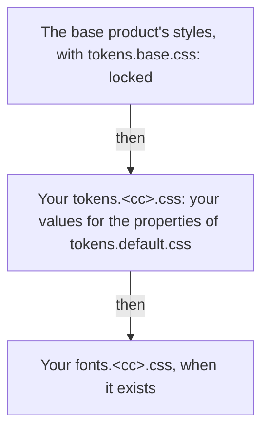

# The designers' brief

For the designer of a country's theme. It says what a theme may change, the rules it must keep, and
how to hand the work to a design tool. Read
[responsibilities-and-upgrades.md](responsibilities-and-upgrades.md) first for who owns what.

## What a theme changes, and where

A theme is a few files in the country repository's `fe/`:

- `fe/styles/tokens.<cc>.css`: the brand tokens, values only. `init` writes it as a copy of the
  default, and you change its values.
- `fe/styles/fonts.<cc>.css` with the face files in `fe/styles/fonts/<face>/`: the text face, when
  the country has its own.
- The branding images in `fe/admin/assets/branding/` and `fe/info/assets/branding/`.

The build loads the base product's styles, its locked tokens among them, then your
`tokens.<cc>.css`, then your `fonts.<cc>.css` ([The seams](../README.md#the-seams--seamsjson)).



Your inputs are the base product's two token files. After set-up you read them at
`fe/.niord/base/styles/tokens.default.css` and `fe/.niord/base/styles/tokens.base.css`.

## The token contract

- **Values only.** Your `tokens.<cc>.css` holds the custom properties of `tokens.default.css`, with
  your values, and nothing else. Add no new token.
- **No base token redeclared.** `tokens.base.css` holds the tokens every deployment shares: the
  mono font (`--niord-font-mono`), the message pin and its labels, the message map's halos and
  count badge, the geometry editor's buffer overlay (`--niord-msg-buffer-fill` and
  `--niord-msg-buffer-stroke`) and its fill, the measure tool, the chart-extent outlines, the
  severity notices, the attention rail and the diff colours. Your file loads after it, so a
  redeclared base token would win. No build check stops that: review does. Never redeclare one.
  The area and chart overlays (`--niord-area-*`, `--niord-chart-*`) are in `tokens.default.css`,
  so they are yours to retune.
- **The accent is not the action colour.** The default makes `--niord-action-primary-bg` an alias of
  the primary colour, and keeps the accent for state and wayfinding: the selection wash, the
  header's brand bar, badges. To make buttons use the accent, point the alias at a step of the
  accent dark enough for the white label's floor ([Contrast floors](#contrast-floors)). Never
  restyle the button classes.
- **The destructive red is semantic, not brand.** Keep `--niord-action-danger-bg: #b52d20` and its
  hover `#9a2418` as they are. Change them only for a deliberate reason.
- **The 18 status tokens are independent.** Six statuses (published, draft, verified, cancelled,
  expired, deleted) each have `-bg`, `-fg` and `-bd`. Keep all 18 as literal values, never a
  `var()` of another token, so a country can tell any two statuses apart. Equal values are
  allowed: the default gives draft and verified the same values, cancelled and expired the same
  values, and most `-bd` the value of their `-fg`.
- **Radius is a real axis.** The default uses 5, 8 and 12 px (`--niord-radius-sm`, `--niord-radius`,
  `--niord-radius-lg`). Smaller radii give a flatter, more official tone to the whole UI.
- **`--niord-font-size-adjust` keeps a non-system face at the right size.** The default is `none`.
  The UI is sized for the system faces, whose x-height is about 0.50 to 0.55 of the font size. A
  face whose x-height lies outside that band sets the token to a number, the x-height ratio it
  should render at (such as `0.52`), so no component needs its own font size. A face inside the
  band keeps `none`. A face's x-height ratio is its `sxHeight` divided by its `unitsPerEm`, both in
  the font file's OS/2 and head tables, or its specimen gives it.
- **The title colour carries hierarchy on hue.** `--niord-fg-title` points at the brand primary,
  because body text is near-black. Keep it a `var()` of a step of your primary scale.

## Contrast floors

The floors are part of the contract. They are WCAG AA: 4.5:1 for text, 3:1 for a border or a bar.
Measure each one in your palette, and write the ratios as a comment on the value's own line, in this
form:

```css
--niord-status-draft-fg: #1a5a97; /* 6.18:1 on -bg; wash 6.31:1 over bg, 6.50:1 over surface */
```

| Token                                          | Floor                                                                                                             | The default's measurement                                                                   |
| ---------------------------------------------- | ----------------------------------------------------------------------------------------------------------------- | ------------------------------------------------------------------------------------------- |
| `--niord-fg-subtle`                            | 4.5:1 on `--niord-surface` (placeholders and captions at body size)                                               | `#667589`, 4.70:1                                                                           |
| each `--niord-status-*-fg`                     | 4.5:1 on its own `-bg`, and on the status badge's wash of that `-bg` over `--niord-bg` and over `--niord-surface` | the lowest, published `#1b7a44`: 4.71:1 on the solid `-bg`, 4.79:1 and 4.93:1 on the washes |
| `--niord-surface-500`                          | 3:1 on `--niord-bg` and on `--niord-surface` (the border of every form field)                                     | 4.39:1 on `--niord-bg`, 4.76:1 on `--niord-surface`                                         |
| `--niord-action-primary-fg`                    | 4.5:1 on `--niord-action-primary-bg` and on `--niord-action-primary-bg-hover`, whichever tokens they point at     | white: 11.17:1 and 13.15:1 on the primary                                                   |
| `--niord-fg-on-primary`                        | 4.5:1 on `--niord-primary`                                                                                        | white: 11.17:1                                                                              |
| `--niord-action-danger-fg`                     | 4.5:1 on `--niord-action-danger-bg` and on its hover                                                              | white: 6.25:1 on `#b52d20`, 7.96:1 on `#9a2418`                                             |
| `--niord-fg-title`                             | 4.5:1 on `--niord-surface`                                                                                        | `#0f3d66`, 11.17:1                                                                          |
| `--niord-header-fg` and `--niord-header-muted` | 4.5:1 on `--niord-header-bg`                                                                                      | 16.70:1 and 6.53:1                                                                          |
| `--niord-header-active`                        | 3:1 on `--niord-header-bg` (the header's brand bar)                                                               | the accent, 4.10:1                                                                          |

The status badge's wash is its `-bg` at 65 % opacity, mixed in sRGB over what lies behind it:
`color-mix(in srgb, <-bg>, transparent 35%)` over `--niord-bg` or over `--niord-surface`. Composite
the colours that way before you measure.

Subtle text also sits on `--niord-bg` and on `--niord-surface-sunken` in places, where the default
measures 4.34:1 and 4.45:1, below 4.5:1. Meet 4.5:1 there too if your palette allows: the default's
shortfall is a known gap, not a model.

White on the default's teal accent measures 4.07:1. So pointing the button alias at an accent of
that lightness fails the floor of `--niord-action-primary-fg`: point it at a darker step of the
accent, or keep the primary.

One more rule has no ratio. Your accent draws the selection rail (`--niord-accent`) and the
selection wash (`--niord-accent-soft`). Keep both clearly distinct from the attention rail, a red
locked in `tokens.base.css` (`#b52d20`, 6.25:1 on white against a 3:1 floor). Measure the distance as
CIE76 ΔE, the distance in CIELAB that `tokens.base.css` uses: the default's teal accent is about 97
from the rail, and a warm orange accent about 39, which that file still calls far. Keep both at
least 39 from the rail.

## Fonts

- Self-host the face. Put its `woff2` files in `fe/styles/fonts/<face>/`, with its licence file
  beside them.
- Declare it in `fe/styles/fonts.<cc>.css`: an `@font-face` rule with a relative `url()` and
  `font-display: swap`. The build hashes each file into its own output, so no other country's build
  carries it.
- Each application's `styles` budget is raised by the size of `fonts.<cc>.css` when it exists
  ([The seams](../README.md#the-seams--seamsjson)). Your face files do not count against the base
  product's budget, but a large face still slows the first visit, so keep to the weights you use.
- Never link Google Fonts, or any `https:` address, for a face or a stylesheet. The build fails
  it ([The checks on every country build](../README.md#the-checks-on-every-country-build)). The
  country's own addresses, such as its authority's site or its accessibility statement, go in
  `fe/build-urls-allowed.json`, each scoped with `app` to the application that links it. A font or a
  stylesheet is never one of them: that list does not admit it.
- In `tokens.<cc>.css`, set `--niord-font-family` to the face first, then a fallback stack, and set
  `--niord-font-size-adjust` if the face needs it. A country with no face of its own keeps the
  default's system stack and `none`.
- The administration app's service worker caches the face for offline use, in its `media` group.

The example country is the model: its [fonts.xx.css](../example/fe/styles/fonts.xx.css) and its
Lato face with the licence, [OFL.txt](../example/fe/styles/fonts/lato/OFL.txt).

## Logos and icons

The branding check reads each image's pixel size from its PNG header:

| Application            | File                                       | Size                  |
| ---------------------- | ------------------------------------------ | --------------------- |
| the public site        | `favicon.png`                              | 32×32                 |
| the public site        | `apple-touch-icon.png`                     | 152×152               |
| the public site        | `logo-gray.png` and `logo-gray-<lang>.png` | 44 px high, any width |
| the administration app | `company-logo-<lang>.png`                  | free                  |

The Niord mark and the administration app's favicon belong to the base product and are not
brandable. What each file is for, and the rest of the branding contract, is in
[Branding](../README.md#branding--brandingschemajson) and
[branding.schema.json](../branding.schema.json).

## A brief for a design tool

Attach `tokens.default.css` and `tokens.base.css` from `fe/.niord/base/styles/`. Fill in the first
three lines of the text below, with your country's code in place of `<cc>`, then paste it:

```text
Country: <the country's name>, code <cc>.
Brand direction: <the brand's colours, or a reference to them, and the tone>.
Text face: <the face, or "none": keep the system stack>.

Design a brand theme for this country's deployment of Niord, a maritime safety information
system with an administration app and a public site for mariners.

Attached are two files. tokens.default.css is the full set of brand tokens, with the default
values and their contrast measurements in comments. tokens.base.css holds the tokens every
deployment shares; read it for context only.

Return ONE file, tokens.<cc>.css, and nothing else:

- Exactly the custom properties of tokens.default.css, under one :root rule, with your values.
  Add none, leave none out, rename none.
- No property from tokens.base.css.
- Values only: no @import, no url(), no @font-face, no font loading of any kind.
- Keep --niord-action-primary-bg and --niord-action-primary-bg-hover aliases: var() of a primary
  or an accent token.
- Keep --niord-fg-title a var() of a step of the primary scale.
- Keep --niord-action-danger-bg #b52d20 and --niord-action-danger-bg-hover #9a2418 as they are:
  the red is semantic.
- Keep the 18 status tokens (published, draft, verified, cancelled, expired, deleted; each -bg,
  -fg and -bd) as 18 literal values, never a var() of another token. Equal values are allowed.
- Meet these floors (WCAG AA), measured with the WCAG 2 contrast ratio:
  --niord-fg-subtle 4.5:1 on --niord-surface, and on --niord-bg and --niord-surface-sunken too
  if your palette allows: the default measures 4.34:1 and 4.45:1 there, below 4.5:1, a known gap
  the base product's backlog records ("The default --niord-fg-subtle is below AA off
  --niord-surface"), not a model;
  each --niord-status-*-fg 4.5:1 on its own -bg, and on the badge's wash of that -bg over
  --niord-bg and over --niord-surface, the wash being the -bg at 65 % opacity mixed in sRGB,
  color-mix(in srgb, <-bg>, transparent 35%);
  --niord-surface-500 3:1 on --niord-bg and on --niord-surface;
  --niord-action-primary-fg 4.5:1 on --niord-action-primary-bg and on its hover;
  --niord-fg-on-primary 4.5:1 on --niord-primary;
  --niord-action-danger-fg 4.5:1 on --niord-action-danger-bg and on its hover;
  --niord-fg-title 4.5:1 on --niord-surface;
  --niord-header-fg and --niord-header-muted 4.5:1 on --niord-header-bg;
  --niord-header-active 3:1 on --niord-header-bg.
- Write each measured ratio as a comment on its value's line, as in
  --niord-status-draft-fg: #1a5a97; /* 6.18:1 on -bg; wash 6.31:1 over bg, 6.50:1 over surface */
- Keep --niord-accent and --niord-accent-soft at least 39 from --niord-attention-rail
  (#b52d20 in tokens.base.css), measured as CIE76 delta E in CIELAB.
- Give --niord-font-family as a family stack only: the face first and the default's system
  stack after it, or the default's stack unchanged when the text face is "none". The face files
  are added separately. Set --niord-font-size-adjust to the face's wanted x-height ratio as a
  number (such as 0.52) when its x-height lies outside about 0.50 to 0.55 of the font size,
  otherwise none.
```

Its output drops into `fe/styles/` unchanged, as `tokens.<cc>.css`. Measure its ratios yourself
before you commit it: a design tool can write a ratio it did not measure.

## How to see it worked

From the country repository's `fe/`:

1. Compare your `styles/tokens.<cc>.css` with `.niord/base/styles/tokens.default.css`: the same
   custom properties, none of `tokens.base.css`, and each ratio comment the ratio you measure.
2. Run `node setup.mjs`.
3. Run `npm run build`. It finishes green.
4. Look at both applications: `npm run start:admin` serves the administration app on port 4200,
   and `npm run start:info` the public site on port 4400. To see them with a backend and data, run
   `./start-local.sh` from the repository root instead
   ([Running it locally](../README.md#running-it-locally--start-localsh)).
