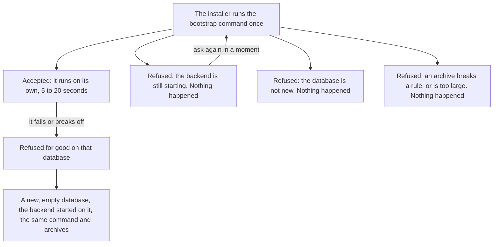
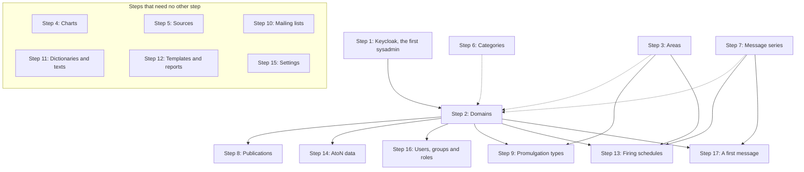
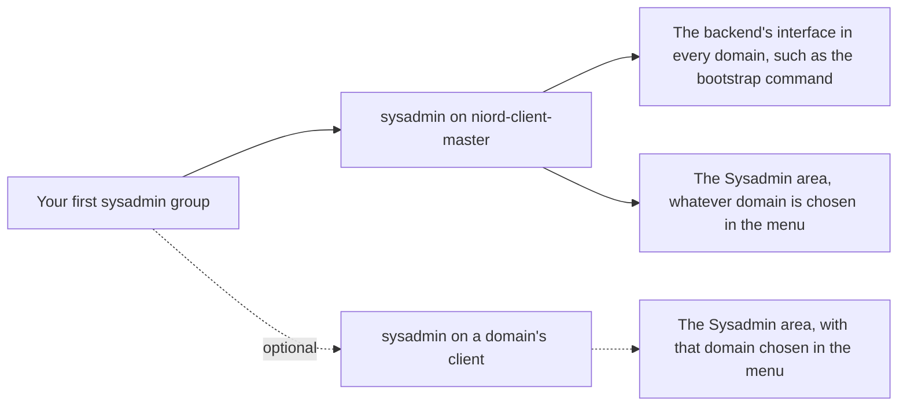

# The operators' guide

For the operators of a country's deployment: its sysadmins and admins. It says what a new deployment
already holds, and what you set up in it yourself, in the order one step depends on another. You
work only in the administration app and in Keycloak's admin console: no code, no files, no
repository. Read [responsibilities-and-upgrades.md](responsibilities-and-upgrades.md) first for who
owns what.

Before you start, the installer has deployed the images and run the bootstrap once on the new
database ([Staging](country-guide.md#staging) in the country guide's Deploy). That part is verified
at the deploy step ([About these guides](README.md#about-these-guides)).

## Finding your way

The administration app's menu has two areas, **Admin** and **Sysadmin**. Each holds sections, and
this guide names a place as area > section: Sysadmin > Domains is the Domains section of the
Sysadmin area. Every section's page has a Help link into the user manuals at
[docs.niord.org](https://docs.niord.org): the
[admin manual](https://docs.niord.org/admin-manual/manual.html), the
[sysadmin manual](https://docs.niord.org/sysadmin-manual/manual.html) and the
[editor manual](https://docs.niord.org/editor-manual/manual.html). This guide links the same pages
and gives each step itself; the manuals describe the pages in full.

The Sysadmin area needs the sysadmin role, and Admin needs admin or more. The app checks your roles
on the Keycloak client of the domain you work in, which you choose in the menu, and on the client
`niord-client-master`, whose roles count in every domain.

## What a fresh deployment holds

The base product's bootstrap gives every new deployment the same start, in English only:

- **The master domain**, Keycloak ID `niord-client-master`, named Master, with no message series and
  no time zone. It is active, so a sysadmin with the role on its client reaches the
  Sysadmin pages on it; a country's bootstrap may leave it inactive by restating it with
  `"active": false` only.
- **The base product's templates and scripts:** the message templates, the mail templates and the
  scripts they use, under Sysadmin > Script Resources.
- **The built-in print reports** `standard`, `draft` and `public`, under Sysadmin > Print Reports.
- **The generic categories**, among them **Firing Exercises**. The firing schedules find that
  category by its exact English name to file the messages they generate. Never rename it.
- **The parameter types** the templates use, under Sysadmin > Parameter Types.
- **The promulgation types** NAVTEX, Twitter and Audio, in English and linked to no domain.
- **The AtoN dictionary**, `aton`, under Sysadmin > Dictionaries, beside the texts the backend
  writes at every start.

It holds no settings beyond those the backend writes at its first start, and no messages.

The country's own bootstrap is applied in the same run, after the base product's. Where it names
something the base product's archive created, its values win. What it holds is your country's
maintainers' choice: typically your domains and their series, your reports, your promulgation types
and links, and your languages on the base product's entries. Ask them for the list.

### How to see it worked

These pages are in the Sysadmin area, which opens once step 1 below is done.

- Sysadmin > Script Resources, Print Reports, Categories, Parameter Types, Promulgation Types and
  Dictionaries list what the bootstrap brought, and Sysadmin > Domains lists the country's domains.
- Sysadmin > Batch Jobs lists the jobs the backend ran since its last start. Right after the
  bootstrap, that is its import jobs (`script-resource-import`, `domain-import`, `category-import`
  and the others), each completed. Their **logs…** say what each added and, for the country's
  archive, what it replaced. A restart of the backend empties the list, so read the logs before
  one. After a restart, the lists of the first bullet are the check.

## The bootstrap: once, on a new database

The installer runs the bootstrap once, after the install, with the base product's archive first and
then the country's. The command itself is verified at the deploy step. It answers in one of these
ways:

- **Accepted.** The bootstrap then runs on its own and takes 5 to 20 seconds.
- **Refused: the backend is still starting.** Nothing happened. Ask again in a moment.
- **Refused: the database is not new.** It holds data, or a bootstrap ran or started on it before.
  The refusal names the state or the first table that holds a row. Nothing happened. If it says a
  bootstrap is running, wait for that one's outcome.
- **Refused: an archive breaks a rule, or is too large.** The answer names the archive and the
  rule. By default an upload takes 50 MB a part and 50 MB a request, which is also the body limit
  of the chart's proxy. Nothing happened.

There is no retry. A bootstrap that failed, or broke off, is refused for good on that database.
The remedy is a new, empty database, the backend started on it, and the same command with the same
archives. Never restart a bootstrap's import job from Sysadmin > Batch Jobs: the page refuses it,
with "The batch execution was not restarted".



## If the sysadmin pages are out of reach

The administration app grants a role from the Keycloak client of the domain chosen in the menu, and
from `niord-client-master` in every domain, also while no domain is chosen. A sysadmin with the
`sysadmin` role on `niord-client-master` therefore reaches the Sysadmin pages whatever the menu
shows, also when a country's bootstrap left the master domain inactive and brought no active domain
of its own: Sysadmin > Domains lists the inactive domains too, and a domain is made active there.

A sysadmin without that role sees Messages only when the country's domain is active but its
Keycloak client does not exist yet, or when the sysadmin holds no role on it. Do step 1 below.

## What you set up, in order

Each step says what to do, where, and how to see it worked. Where a domain field names something a
later step creates (areas, categories, series), come back to the domain once it exists.

Each step starts with its tag: **Mandatory** for every deployment, or **When it applies** for a
deployment that has the case its line names. The guides' index explains the tags
([What is mandatory, and what is optional](README.md#what-is-mandatory-and-what-is-optional)).

The drawing shows every step, all 17. An arrow leads from a step to a step that needs it, and a
dotted arrow is a domain field that names a later step's data. Step 1 opens the administration app
for every other step, so only its arrow to step 2 is drawn. The steps in the box need no other step,
and no step needs them.



### 1. Keycloak: who may sign in, and the domain clients

**Mandatory.** In Keycloak's admin console, in the realm the deployment signs in to:

- The client `niord-web` is the administration app's sign-in.
- Each domain is a client whose client ID is the domain's Keycloak ID. It holds the roles `user`,
  `editor`, `admin` and `sysadmin`, each including the one before it. No one signs in through it;
  it only holds roles. A role on it counts while that domain is chosen in the menu.
- The client `niord-client-master` is the base product's own. A role on it counts in every domain,
  in the backend's interface, such as the bootstrap command, and in the administration app alike:
  `sysadmin` there opens the Sysadmin area whatever domain is chosen in the menu, and `admin` and
  `editor` open their areas the same way. Give a role there only to a person who is to hold it in
  every domain.
- The app acts in Keycloak with the signed-in person's own rights. A sysadmin who creates domain
  clients needs the `realm-management` client's `manage-clients` role, and an admin who manages
  users needs its `manage-users` role. Give these through a group.

Give your first sysadmin the `sysadmin` role on `niord-client-master`. It opens the Sysadmin area
in every domain, and the backend's interface, such as the bootstrap command. The `sysadmin` role on
a domain's client is then optional for this person; it is how a sysadmin of one domain alone is
made.



With that role, your sysadmin presses **Create in Keycloak** for the first domain too (step 2), so
no client has to be made by hand. Making one by hand is optional, for a realm whose first sysadmin
is to hold no role on `niord-client-master`: that sysadmin reaches the Sysadmin area only through
the first domain's client, so create it by hand, unless the realm the installer set up already
holds it. Ask your maintainers for that domain's Keycloak ID.

1. Clients, **Create client**. The client ID is the domain's Keycloak ID. Keycloak's defaults on
   the next two pages work, since the client only holds roles. Save. (**Create in Keycloak** makes
   its clients from the backend's template: the domain's name as the name, bearer-only, **Client
   authentication** on, **Standard flow** and **Direct access grants** on and the other flows off,
   `/*` as the redirect URI, and full scope off.)
2. On the client's **Roles** tab, create `user`, `editor`, `admin` and `sysadmin`.
3. Open `editor` and add `user` as an associated role. Do the same for `admin` with `editor`, and
   for `sysadmin` with `admin`.
4. Give the first sysadmin's group the client's `sysadmin` role: Groups, the group, **Role
   mapping**, **Assign role**, filtered by clients. Users, the user, **Groups** names the user's
   group.

Every client not made by hand comes from **Create in Keycloak**: save the domain in step 2, open it
again, and press the button. Whether the installer's realm holds the first client, and the
production realm itself, are verified at the deploy step.

How to see it worked: your sysadmin signs in and the Sysadmin area appears in the menu (with a role
on a domain's client only, once that domain is chosen there). After **Create in Keycloak**,
Sysadmin > Domains shows a tick beside the domain's Keycloak ID, and the domain's editor says the
client exists in Keycloak. The manual:
[Keycloak integration](https://docs.niord.org/sysadmin-manual/manual.html#keycloak-integration).

### 2. Domains and their time zones

**Mandatory.** Every domain has its time zone, and its client from **Create in Keycloak**, unless
that client was made by hand (step 1). Create with **New Domain** only the domains your bootstrap did not
bring; open each one it brought with the pencil, check its fields, and press **Create in Keycloak**.

Sysadmin > Domains, **New Domain**. Give each domain:

- a **Keycloak ID**, unique, which is also its Keycloak client;
- **Active** ticked: only an active domain appears in the menu's domain list;
- a **Name**;
- a **Time Zone**. Choose the zone of the waters the domain covers; leave none blank by accident.
  The zone formats the times the administration app shows while this domain is chosen in the
  menu; with no zone, the app shows times in the browser's own, and every date field is disabled
  until the domain has a zone, its tooltip reading "No time zone: choose a domain, or ask a sysadmin
  to give this domain a time zone". It also formats the times the backend writes
  into the domain's message texts and documents, the PDFs the public site offers among them. The
  public site's pages do not read it: they show times in the zone your country's build names, UTC
  unless the maintainers set another. That zone is your maintainers' setting, not yours: ask them to
  set it to the zone you choose here
  ([The public site's time zone](country-guide-in-depth.md#the-public-sites-time-zone));
- **Publish** ticked for a domain whose messages the public site shows. The field's hint reads
  "Promulgate messages by default"; in this app the public site and the public interface serve only
  the messages of domains that are active and have Publish ticked;
- the map centre, sort order, colour and the AtoNs and Templates flags as the manual describes.

Then press **Save Domain**, open the domain again with the pencil, and press **Create in Keycloak**.

How to see it worked: the domain is in the list with its time zone, and in the menu's domain list.
The manual: [Domains](https://docs.niord.org/sysadmin-manual/manual.html#domains). Two things the
manual leaves out: **Create in Keycloak** shows only on a saved domain, and the copy button beside
the pencil starts a new domain from an existing one.

### 3. Areas

**When it applies:** for the areas your bootstrap did not bring. A message needs no area, so a
deployment whose bootstrap brought its areas skips this step.

Admin > Areas, **New area** and **New sub-area**, as a tree. An area of type **Firing area** gets a
firing schedule in step 13.

How to see it worked: the tree shows the areas, and a domain's **Areas** field offers them. The
manual: [Areas](https://docs.niord.org/admin-manual/manual.html#areas).

### 4. Charts

**When it applies:** if your messages name the charts they concern.

Admin > Charts, **New Chart**, or **Import...** from the page's menu with a file your maintainers
give you.

How to see it worked: the chart list shows them, and the message editor's chart field offers them.
The manual: [Charts](https://docs.niord.org/admin-manual/manual.html#charts).

### 5. Sources

**When it applies:** if your messages name their sources.

Admin > Sources, **New Source**.

How to see it worked: the message editor's source field offers them. The manual:
[Sources](https://docs.niord.org/admin-manual/manual.html#sources).

### 6. Categories

**When it applies:** if you need categories beyond the bootstrap's, or a domain offers only some of
them. A domain with no categories linked offers every category except those whose own **Domains**
field names other domains only. The base product's categories name no domain.

Sysadmin > Categories, **New category** and **New sub-category**. A category may be a template
category, with its script resources and template parameters. Link categories to domains in the
category's **Domains** field or the domain's **Categories** field. Keep the name **Firing
Exercises** as it is.

How to see it worked: the tree shows the categories, and the message editor of a linked domain
offers them. The manual: [Categories](https://docs.niord.org/sysadmin-manual/manual.html#categories).

### 7. Message series and their numbering

**Mandatory.** Every domain you write messages in has its series: a message is verified and
published only with one. Create those your bootstrap did not bring.

Sysadmin > Message Series, **New Message Series**: the **Message Series ID**, the
**Main Type** (Navigational Warnings or Notices to Mariners), the **Number Sequence Type** (Yearly,
Continuous, Manual or None), the **Short Format** with its tokens, and for a warning series the
**NAVTEX Preamble**. **Next number** sets the number the next published message gets; a number below one a message of
the series already has is refused, and **Compute** gives the next free one. Then add the
series to its domain: Sysadmin > Domains, the domain's **Message Series** field.

How to see it worked: the series list shows the series with its sequence and next number, and the
domain list shows the series beside its domain. The manual:
[Message series](https://docs.niord.org/sysadmin-manual/manual.html#message-series). This app
adds a **Search Index** field, which leaves a series' messages out of the free-text search.

### 8. Publication categories and publications

**When it applies:** if you issue publications, or your messages cite them.

Admin > Publication categories first: each category groups publications on the public site, and its
**Show on the public site** decides whether they appear there. Then Admin > Publications, in the
domain the publications belong to: **New** creates a publication series, and its issues are
released under it. **Can be cited from messages in** names the domains whose messages may cite it.

How to see it worked: the publication appears on the public site's publications page when its
category is shown there and an issue is published. The manual's
[Publications](https://docs.niord.org/admin-manual/manual.html#publications) chapter describes the
earlier page: this app's series and issues work as the page's own texts say.

### 9. Promulgation types and their transmitters

**When it applies:** if you promulgate messages, by NAVTEX, SafetyNET, Twitter, audio or a service
of your own.

Sysadmin > Promulgation Types. **Add Promulgation Type** for each of your own (a SafetyNET type, a
second NAVTEX type), choosing its **Service ID**. For the base product's NAVTEX, Twitter and Audio,
open each with the pencil and set its **Domains** and its **Language**. A type's own settings open
from its editor once it is saved: a NAVTEX type's **Transmitters** and a SafetyNET type's **Areas**,
each with **Manage...**, and Twitter's **Settings**, with **Update Settings...**.

How to see it worked: the list shows each type with its domains and language, and the message
editor of a linked domain offers it. The manual:
[Promulgation types](https://docs.niord.org/sysadmin-manual/manual.html#promulgation-types).

### 10. Mailing lists and their triggers

**When it applies:** if you send messages by mail.

Admin > Mailing Lists, **New Mailing List**, then **Add Trigger**: a Status Change trigger (for
Published, Cancelled or Expired) or a Scheduled one, each with the template it sends. Add the
recipients with **Manage Recipients**: users, and contacts from Admin > Users & Contacts, Contacts
tab.

How to see it worked: **Test trigger** on a trigger, then Sysadmin > Mail Queue shows the mail. The
manuals: [Mailing lists](https://docs.niord.org/admin-manual/manual.html#mailing-lists) and their
[triggers](https://docs.niord.org/sysadmin-manual/manual.html#mailing-list-triggers).

### 11. Dictionaries and texts

**When it applies:** if a text the backend serves needs other wording, or your maintainers give you
a dictionary file.

Sysadmin > Dictionaries holds the texts the backend serves (`web`, `message`, `mail`, `pdf` and
`template`) and the AtoN dictionary. Change a value with the pencil. **Import...** takes a
dictionary file and shows a preview first: **Would add** for keys this deployment lacks, ticked, and
**Would overwrite** for keys it has with other values, which change only when you tick them.

How to see it worked: the changed text shows where it is used, after a reload. The manual:
[Dictionaries](https://docs.niord.org/sysadmin-manual/manual.html#dictionaries).

### 12. Templates and reports, by import

**When it applies:** when your maintainers give you a template's, script's or report's import file.

The templates and reports your country adds or changes arrive as import files from your
maintainers, never by themselves.

Sysadmin > Script Resources, **Import...**: the preview lists **Would add** (ticked), **Would
overwrite** (unticked), **Unchanged** and **Refused** with each path's reason. **Show diff** puts
this deployment's row beside the file's. An overwrite happens only for a path you tick. **Import
ticked** starts the import job. Every write is recorded with your user name and the source Import,
and the pencil's **Revision History** shows it.

Sysadmin > Print Reports, **Import...**, has no preview: a report the file names replaces the
report with the same id whole. **Export...** first, to keep a copy.

How to see it worked: the import's batch job is completed, and the script resource's revision
history shows the import. The manual:
[Script resources](https://docs.niord.org/sysadmin-manual/manual.html#script-resources) and
[Print reports](https://docs.niord.org/sysadmin-manual/manual.html#print-reports).

### 13. Firing areas and their schedules

**When it applies:** if your waters have firing areas.

The firing areas are areas of type **Firing area** (step 3). One domain holds a message per firing
area, and another receives the generated firing exercises, each with its series. Then Sysadmin >
Firing Schedules, **New Firing Schedule**: the **Domain**, the **Target Domain**, the **Target
Message Series**, the **Scheduled Days**, and **Generate firing exercises** ticked.

How to see it worked: in the firing areas' domain the menu shows **Schedule**, the Firing Area
Schedule page. A scheduled exercise appears there, and after **Update Firing Exercises…** as a
message in the target domain under the category Firing Exercises. The manual:
[Firing schedules](https://docs.niord.org/sysadmin-manual/manual.html#firing-schedules).

### 14. AtoN data

**When it applies:** if a domain shows AtoNs.

The administration app has no page that loads AtoN records. A domain's **AtoNs** flag switches the
AtoN layer on for that domain, and the AtoN dictionary comes with the bootstrap. Ask your country's
maintainers how your deployment gets its AtoN records.

### 15. Settings

**Mandatory.** Sysadmin > Settings lists the settings an operator may change, with **Filter**. The
pencil changes a value, and only the value. There is no reset and no delete. Only the keys the code
declares are listed: a row of an earlier version that no code declares stays in the database,
unlisted. A password value is never shown. **Import...** and **Export...** take a settings file.

Check at least the addresses (`baseUri`, `adminAppUrl`, `authServerUrl`), the mail sender
(`mailSender`), who mail really goes to (`mailValidRecipients`: `LOG`, the shipped value, only logs a
mail and marks it Held in the Mail Queue, from where a sysadmin can send it again once the setting is
open; `ALL` sends it to its recipients, and a list of addresses sends it only to those, any other
recipient replaced by the first and the mail marked Held, so under a list most mails show as Held),
the deployment ribbon (`mode`: anything but `production` shows a ribbon in both applications; the
shipped settings file says `test`), and `documentationUrl`, which
the Help links open. A copy of production's data carries production's values of these two, so give
each environment its own at the server's start (below). The language keys are in
[A new language in a running deployment](#a-new-language-in-a-running-deployment).

A value can also be given to the server at its start, as a system property or an environment
variable with the setting's name. For a text setting, such a value wins over the page's, and the
page does not show it. A list or other JSON setting, such as `modelLanguages`, is changed on the
page only: both applications read its stored value whatever the server was given, and the server
cannot read a list given that way. The page lists the stored value, and the pencil changes that one, which the server uses only once
the start-up value is no longer given. The local launcher gives `adminAppUrl` that way, so on a
local run its row may read empty while the server uses the launcher's address. Ask your installer
which settings a deployment gives at its start.

How to see it worked: the list shows the new value. The manual:
[Settings](https://docs.niord.org/sysadmin-manual/manual.html#settings) describes the earlier
model: its file and environment sections no longer hold.

### 16. Users, groups and roles

**Mandatory.** In Keycloak's admin console, give people their roles through groups: a group holds a
domain client's role (`user`, `editor`, `admin` or `sysadmin`). The app shows a person what their
role on the chosen domain's client allows, so a person who works in three domains needs a role on
each of the three clients. A role on `niord-client-master` counts in every domain, for the
backend's interface, such as scripts and the bootstrap command, and for the app's areas and menus
alike: give it only to a person who is to hold that role in every domain.

Admin > Users & Contacts, Users tab, searches the realm's users, adds one with **Add**, and moves a
user in and out of the current domain's groups. Niord keeps its own record of a person from their
first sign-in.

How to see it worked: the person signs in and sees the areas their role allows. The manuals:
[Users & contacts](https://docs.niord.org/admin-manual/manual.html#users-contacts) and
[user groups](https://docs.niord.org/sysadmin-manual/manual.html#user-groups).

### 17. A first message

**Mandatory.** In the menu's **Editor**, choose a domain with a series, then **New blank NW**. Fill
in the **Type**, which is required; the series, in the **ID** field, which is chosen already when
the domain has one series; the area; and the text. Save. On the message's status page use **Verify
message…**, and then **Publish message…**, which a draft does not offer until it is verified.

How to see it worked: the message has its number in the series' short format, and it shows on the
public site. On a local run that is checked by hand; on a deployment it is verified at the deploy
step. The manual: [Editor](https://docs.niord.org/editor-manual/manual.html#editor) and the
[status page](https://docs.niord.org/editor-manual/manual.html#status-editor-page).

## A new language in a running deployment

**When it applies:** when your maintainers ship a new language. A deployment that already has its
settings keeps them: the backend adds at its start only the settings it lacks, and never changes one
it has. So the new language stays off in both applications until you turn it on. Once the version
with the language runs, on Sysadmin > Settings, change with the pencil:

- `modelLanguages`, a JSON list such as `["en", "zz"]`: the message languages, a field each in the
  editor;
- `siteLanguages`, a JSON list: the administration app's languages. A language the build ships no
  texts for is left out;
- `infoSiteLanguages`, a JSON list: the public site's languages, again only those the build ships;
- `defaultLanguage`, a text such as `zz`, only when the new language becomes the default. It must be
  one of `modelLanguages`; otherwise the first of them is used;
- `infoDefaultLanguage`, a text, only when the new language becomes the public site's default. It
  must be one of the public site's languages; otherwise the first of them is used.

Ask your maintainers which of the lists the language joins: a language may be a message language
only, without texts for the applications. For the two text keys, `defaultLanguage` and
`infoDefaultLanguage`, a value the server is given at its start wins over the page (step 15). The
three lists are JSON, and both applications read the value the page shows. Then reload both
applications: each reads its languages when it loads.

How to see it worked: the administration app's language menu in its header lists the language, and
the editor shows a field for it. The public site's menu offers it beside its other languages.

The names and texts that exist already, such as those of areas, categories and domains, have no
text in the new language until someone fills its field in their editors, or imports a file your
maintainers give.

## The server's home folder

The backend keeps a cache in its home folder: the message index, the issues' previews, the
thumbnails, the map images and the map tiles, each made again when it is missing; and the files of
the batch jobs. The repository's files and the published documents are rows of the database, which
is the one thing to back up. The setting `niord.home` names the folder. Your country's own defaults
set it to `${NIORD_HOME}`, which the server reads as the folder the deployment mounts; the base
chart always sets `NIORD_HOME`.

A backend whose `niord.home` names no folder does not start: `${NIORD_HOME}` with no `NIORD_HOME`
set, or an empty value. Its log says, at ERROR,
`niord.home cannot be resolved: its value is "${NIORD_HOME}" (from the settings file) and no NIORD_HOME is set; set the environment variable NIORD_HOME or start with -Dniord.home=<folder>`
(or `from the database's niord.home setting`, the value a started database holds), and the start
stops before anything is written under the home.

How to see it worked: Sysadmin > Settings lists `niord.home` with the value `${NIORD_HOME}`. The
backend's start log says `Default setting niord.home = ${NIORD_HOME} (country)`. Do not change the
value on the page. The volume itself is verified at the deploy step.

The base product's generic deployable, without a country, follows `NIORD_HOME` too:
when no `niord.home` property or variable is set, its `niord.home` takes the `NIORD_HOME` system
property, else the environment variable, ahead of the database row; only without any of them does
it fall back to `${user.home}/.niord`. Check the Settings page on such a deployment before anyone
enters data.

**The execution mode.** A fresh database starts in mode `test`: both frontends then
show a TEST ribbon, the public site included. A production deployment adds `-Dmode=production` to
its chart value `app.javaOpts`, which the chart passes to the backend as `JAVA_TOOL_OPTIONS`; keep
the options the value already holds, such as `-XX:MaxRAMPercentage=70.0 -XX:+UseG1GC`, the chart's
default. The chart's `app.settings` does the same without touching `app.javaOpts`:
`app.settings.mode: production` reaches the backend as an environment variable named `mode`. The
backend reads a system property or environment variable named like a setting ahead of the stored
row, so no database edit is needed, and a deployment whose values forgot it shows the ribbon
instead of passing as production.

## The server's clock

The backend runs in UTC. Times stored without a
zone are written and read in the server's zone, so a server on a zone with summer time would shift
them by an hour in the autumn hour that happens twice. The domains' time zones (step 2) format what
the administration app and the backend's documents show; the public site uses the zone its build
names (step 2). The image and the chart set `TZ=UTC` on the backend's pod, outside
`app.javaOpts`, so a value that replaces `app.javaOpts` keeps it; do not add `-Duser.timezone`
there. At the deploy step, check it in the running pod: `kubectl exec <pod> -- printenv TZ` prints
`UTC`.

## Cut-over from an existing deployment

**When it applies:** if your deployment takes over an existing database. Such a deployment is not
bootstrapped: the database holds data. Templates are data in the database, so a template the new
version needs and the old database never had is missing until you import it.

- **Read the missing-path report first.** In the app you see it in the Script Resources import's
  preview: an add the report lists is marked **In the missing-path report**, and **Only the paths
  the missing-path report lists** ticks those and no other. Import only them, and tick no
  overwrite. The backend also logs the report at every start.
- **An import is your own decision**, never a step of an upgrade. Data on any environment other than
  a developer's own changes only when a person says so.
- **A stale script row** copied from an older deployment stays as it is until a sysadmin imports the
  release file that carries the current one and ticks its overwrite.
- **The message index**: an index the backend cannot read in the home folder's `message-index` folder (one of
  an older Lucene format, or a damaged one) is removed at the start, with a WARN that names the folder, and
  rebuilt from the database. After a start the backend rebuilds the Lucene index from the first message
  (`messageIndexDeleteOnStartup`, `true` by default), 5,000 messages a minute. The PostgreSQL search table
  is kept in the database and catches up from the last message it holds; it fills from the first message
  only when it is empty, as in a copy restored from the old system. Each index reads incomplete until its
  first pass after the start has caught up, and until then a free-text search answers from part of the
  messages. Each logs one INFO line when it is complete, such as
  `Message search index complete: Lucene, <n> messages indexed in this fill` (and the same for
  `PostgreSQL`, where `0 messages` after a restart means none was missing), and a system administrator's
  `GET /rest/monitor/message-index` answers `{"lucene":true,"postgres":true,"complete":true}` once both
  are: a script that prepares a copy polls it until `complete` is true before it checks the searches or
  hands the copy over. The answer is that of the backend process that answers; with several backend pods,
  ask each.
- **The jobs that act on the copied data.** From its first minute the backend publishes the messages
  the database holds as due, expires those past their end, runs the firing schedules, sends the Mail
  Queue's pending mails and runs the mailing lists' due triggers. To start on the data without that,
  until you have checked it, add these to the chart value `app.javaOpts`, beside the options it
  holds, and take them out again for the start that puts the deployment to use:

  ```text
  -Dniord.schedule.auto-publish-cron=- -Dniord.schedule.auto-expire-cron=-
  -Dniord.schedule.firing-exercise-cron=- -Dniord.schedule.mail-send-cron=-
  -Dniord.schedule.mailing-list-trigger-cron=-
  ```

  `mailValidRecipients` given as `LOG` at the start (step 15) keeps the mail from leaving, but the
  jobs would still change the data. With the filter at `LOG` and the mail job running, the copy's
  due pending mails become Held, at most `mailMaxPerMinute` of them a minute, so the filter is opened
  only when no due mail is left Pending, and a sysadmin chooses which to send again (the sysadmin manual's
  "Sending a Mail Again"); with `-Dniord.schedule.mail-send-cron=-` they stay Pending instead, and
  all go out by themselves once the job runs with the filter open. To get the choice, let the mail
  job run while the filter is `LOG`.

Every part on a real volume is verified at the deploy step.
