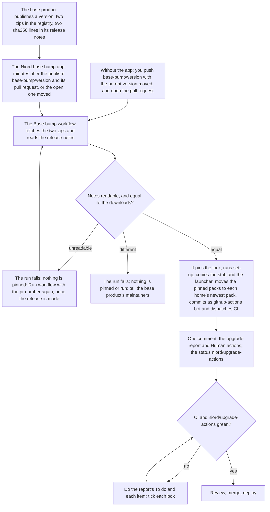

# Responsibilities and upgrades

For everyone who works on a country: the people who set it up and keep it running, its designers,
its operators and the agents that help them. It says what the base product gives you, what you own,
and how you move your country to a new base version. "You" is the country's maintainer.

Read it before you start a country: it is the contract you sign up to. It is an overview, so you do
not need to understand any point here before you start. The [country guide](country-guide.md)
and its [in-depth guide](country-guide-in-depth.md) explain each point step by step, for setting up
and building your country. The
[operators' guide](operators-guide.md) does the same for the running system. The steps of an upgrade
are below, in [How an upgrade works today](#how-an-upgrade-works-today).

## What you get with every base version

- All the base product's functionality, fixes and security fixes, in both applications and in the
  backend.
- The build itself: the build options, the budgets, the service worker, the generated workspace,
  the kit and its checks, the public site's container with its nginx configuration and security
  headers, and the image tools.
- English text for every key, and the key catalog that tells each pack what is new.
- The country API, with a compatibility promise (below).
- An [upgrade report](#the-upgrade-report) for each version change, and an upgrade test in the
  base product's CI. That test builds an example country from the previous version, so a break is
  caught before the base product publishes it.
- New extension points when your need is general: a hook instead of an override.
- The guides, `init`, the example country, and the base product's dependency security alerts: a fix
  arrives with the version.
- The country launcher, `start-local.sh`, which `init` writes at your repository root. One command
  starts your whole stack on your machine with your own bootstrap, or with `--sample` on the base
  product's sample deployment ([Running it locally](../README.md#running-it-locally--start-localsh)).

## What the base product's maintainers owe you

- They keep the country API stable, and document and deprecate every change to it.
- They keep the example country and the acceptance and upgrade tests green. These tests are the base
  product's promise to you.
- They mark security fixes in [security.json](../security.json) and raise them to every country
  with priority.
- They review your requests for extension points, and add them when the need is general.
- They never ship country-specific code, text or data in the base product, and they publish English
  only.

## What you own and maintain

### Every country

This is the minimum, and for most countries it is all they need.

- Your [manifest](country-guide-in-depth.md#the-manifest-field-by-field), your
  [seams](country-guide-in-depth.md#seams-and-own-code), your
  [branding, legal texts and styles](country-guide.md#make-it-yours), and your
  [font](designers-brief.md#fonts) if you have one of your own.
- If you are home to a language: your [home packs](country-guide-in-depth.md#languages), for
  yourself and for every country that uses them. Translate new keys when the base product publishes
  them. A home's pack is a service to others, so do not let it lag far behind.
- Your [pipeline](country-guide.md#pipelines), your
  [images and your deployments](country-guide.md#deploy). Take new base versions promptly, above
  all those marked for security.
- Your backend country module, by the same rules: its
  [settings file and its bootstrap](country-guide-in-depth.md#what-init-wrote-file-by-file), and
  [your logo in its PDFs](country-guide.md#your-logo-in-the-pdfs) (an image override in
  `be/overrides.json`, or a footer template of your own in the bootstrap). Its
  [country texts](country-guide-in-depth.md#your-texts) and
  [release import files](operators-guide.md#12-templates-and-reports-by-import) too, if you have any.
  A sysadmin runs the bootstrap
  [once, on a new database](operators-guide.md#the-bootstrap-once-on-a-new-database).

### Advanced, only if you choose them

Most countries need none of this. An upgrade's cost grows only with what you put here, overrides
most of all ([When it is red](#when-it-is-red)).

- Your [guarded overrides](country-guide-in-depth.md#guarded-overrides), and any static image
  beyond the logo that your backend [overrides](country-guide-in-depth.md#other-image-overrides)
  (`be/overrides.json`). Each one is maintenance debt: you review it at every upgrade that changes
  the file it copies.
- Your [own functionality](country-guide-in-depth.md#pages-menu-entries-hooks-and-slots) (pages,
  hooks, slots), your [country npm packages](country-guide-in-depth.md#your-own-npm-packages) and
  their security alerts.
- Your [escape hatch](country-guide-in-depth.md#the-escape-hatch) and your
  [text overrides](country-guide-in-depth.md#text-overrides). Keep them short.
- Your own [end-to-end specs](country-guide-in-depth.md#end-to-end-specs-of-your-own) and
  [integration tests](country-guide-in-depth.md#integration-tests-of-your-own), beside the base product's
  country checks. A version that changes the pages or the data one of them tests breaks it until you
  fix it.

## What you never do

- Edit a generated file.
- Change base product code, except through a guarded override.
- Override protected code.
- Put secrets in frontend files.
- Add country text to a base product pack.

## The compatibility promise

The promise covers every country, not only the advanced ones: the country API your own code imports
(your pages, hooks and slots, the public site's footer your legal documents need, and the types of
your seam files, such as `InfoConfig` in `info.config.ts`) and the
[set-up stub](country-guide-in-depth.md#the-frontend-and-the-repository) every country commits.
Overrides are outside it: only an override reaches the base product's internals.

The country API is what your code may import from the base product. It is a contract kept across
base versions:

- Every export has a contract comment that says what it is for and which extension point it serves.
- A change that breaks the API is named in its pull request and recorded in
  [API-CHANGES.md](../API-CHANGES.md), with what you must do.
- An export is deprecated before it goes. Its contract comment gets a line
  `Deprecated since <version>: <what to use instead>`, and `node setup.mjs` warns about every use of
  it in your files. It goes only after at least one base version that the countries building on it
  have taken.
- A change to the set-up stub is a breaking change too, recorded the same way.
- The example country builds against the API in the base product's CI, so a break cannot pass
  unnoticed.

Read [the policy](../API-CHANGES.md#the-compatibility-policy) for the whole text.

## How an upgrade works today

Each base version moves in **one pull request in your own repository**, `niord-<cc>`, never in the
base product's. It changes only your repository's files, and a person reviews and merges it: nothing
merges a base bump automatically. The Niord base bump app opens it minutes after each release, on a
`base-bump/<version>` branch that moves only the `<parent>` version in `be/pom.xml`; a newer release
moves the same pull request, and a branch that comes to conflict with `main` is replaced by a fresh
one. The Base bump workflow, `.github/workflows/base-bump.yml`, then pins the lock on that branch,
moves the pinned packs to each home's newest pack, and posts what is left for a person to do.
Without the app on your repository, you open the pull request yourself
([Without the app](#without-the-app-push-base-bumpversion)).

1. **The Niord base bump app opens the pull request.** Minutes after each release, the base
   product's publish run reads the `<parent>` of your `be/pom.xml`. When the release is newer, it
   pushes `base-bump/<version>` from `main` with that one change, opens a pull request into `main`
   and asks the code owners of `be/pom.xml` in `.github/CODEOWNERS` for review. A newer release
   moves the same pull request on its branch. The title and the description are the app's and are
   rewritten at each move, so nothing of the bump is kept there: the description points at the Base
   bump comment and the check `niord/upgrade-actions`. Your commits on the branch stay, nothing
   merges by itself, and when the comment is posted again a box keeps its tick when the thing it is
   about is unchanged: its text, and for a template its content in the kit. If the branch comes to
   conflict with `main`, the next release opens a fresh pull request and closes this one with a
   comment; your commits stay on the old branch.
2. **The Base bump workflow pins the lock.** It runs on the pull request. It fetches the new
   version's two zips from the registry and reads the notes of release `v<version>` in the base
   product's repository, which give their two sha256 lines. Only when the notes and the downloads
   agree does it go on: it pins `base` and `kit` in `fe/niord-pins.lock.json` and runs set-up, with a
   record of the old version that a set-up at the base branch made (when that fails, the report
   compares with the old version by version). It copies `.niord/kit/templates/setup.mjs` over
   `fe/setup.mjs` when the kit changed the stub, and `.niord/kit/templates/start-local.sh` over
   `start-local.sh`. It moves every pinned pack to its home's newest pack
   (`node setup.mjs --update-pins`), pulled and verified by its digest, and the comment names each
   moved pin, old and new, and asks for a first pin's digest to be compared with the summary of the
   home's Pack run that published its tag. It commits as `github-actions[bot]`, cancels the
   branch's CI runs and dispatches `ci.yml` on the new commit, then posts the Base bump comment and
   sets the status `niord/upgrade-actions`. The workflow reads the notes with your repository's own
   token: the base product's repository is public. When the notes and the
   downloads differ, the run fails and nothing is pinned or run: tell the base product's
   maintainers. When the notes cannot be read (a release not made yet, a rate limit, a server
   error), the run fails and nothing is pinned: run it again (Actions, Base bump, Run workflow,
   `pr <n>`).
3. **Read the comment.** The Base bump comment, one per pull request, starts with
   `## Base bump: <old> to <new>` and what was pinned and copied, and a line naming every other kit
   template that changed, which asks nothing. Then come `## Human actions`, as
   boxes, or "No human action: review, merge, deploy."; then `## Checked by CI`; and last the whole
   upgrade report, folded. Read `## Human actions` first, then the report's **To do** and
   **To look at**. After a set-up of your own the report is also `fe/.niord/niord-upgrade-report.md`.
4. **Do each To-do item** on the pull request's branch. [When it is red](#when-it-is-red) says what
   each one means; set-up fails in CI until it is done, so run `node setup.mjs` again until it
   passes. A newer release moves this pull request and your commits stay; if the branch comes to
   conflict with `main`, the next release replaces the pull request.
5. **Do each human action, and tick its box.** Each item is one thing set-up cannot check: the
   "What a country must do" of a new section of `.niord/kit/API-CHANGES.md`; a changed template to
   merge, such as `.niord/kit/templates/AGENTS.md` into your `AGENTS.md`, keeping your own sections
   (`init` keeps an existing `AGENTS.md`, so nothing else brings the template's changes to an AI
   agent); a workflow file to copy or merge by hand (`pack.yml`, `base-bump.yml`, `image.yml`: the
   workflow's token may not push one); each new bootstrap folder `releases/<yyyy-mm-dd>-<topic>/` to
   decide on (a sysadmin imports it; nothing arrives by itself); each template of your
   `be/bootstrap/templates/` that replaces a base product template the new version changed, your
   copy at its path or a language variant `x_<ll>.ftl` of it, to compare with the new one and carry
   the change into (the base product's change never reaches your file). Do each in full, then tick
   its box; never delete one. Each tick recounts, and the status turns green when no box is left unticked.
   Set-up checks none of the API-CHANGES.md actions, so a green set-up does not mean they are done:
   open each new section and do its "What a country must do" in full, whether the report lists it
   under To do, under To look at, or not at all. When one touches the backend, read the new
   version's backend contract at `.niord/kit/docs/country-api.md`, and compare your settings file
   with the new version's `.niord/kit/backend/defaults/base/settings.json`
   ([The base product's backend files](country-guide-in-depth.md#the-base-products-backend-files)).
6. **Review, merge, deploy.** Green means no task: review, merge, deploy. Green is CI and
   `niord/upgrade-actions` both green on the pull request's last commit. Until your repository has a
   rule that requires these checks, which GitHub's free plan does not offer a private repository, a
   red status does not block the merge button: the review is the gate, so do not merge while either
   is red. While the upgrade contract is paused
   ([Paused until production](../README.md#paused-until-production)), a bump is merged when its CI
   is green and the boxes of the comment are information.

It worked when CI is green, `niord/upgrade-actions` is green with every box of the comment ticked,
and the review is done.

### Without the app: push `base-bump/<version>`

The same Base bump workflow runs on a pull request you open yourself: it runs on a pull request from
a `base-bump/` branch of your own repository that changes `be/pom.xml`.

1. From an up-to-date `main`, create the branch `base-bump/<version>` in your own repository, never
   in a fork: the workflow pushes only to a branch of this repository.
2. Move only the `<parent>` version in `be/pom.xml` to the new version, commit and push.
3. Open the pull request into `main`. The workflow runs on it as on the app's, and steps 2 to 6
   above hold as they stand.

With the app installed, a pull request a person opened on `base-bump/` is left alone, and the app
opens no other while it is open. When a bump merged by hand has brought `main` to the released
version or past it, the app closes its own older pull request with a comment.

If you pin the lock by hand before the pull request opens, its first run only recounts and sets the
status pending,
`Base bump: no comment yet; run the workflow on this pull request (Run workflow, pr <n>)`. Run it
(Actions, Base bump, Run workflow, `pr <n>`) for the report and the checklist. Ticking a box and Run
workflow use the copy of `base-bump.yml` on `main`, so they do nothing until it is on `main`.

**Before the Base bump workflow is on `main`**, at the bump that brings it, do the whole bump
yourself, on your machine:

1. In a fresh clone at the current version, run `node setup.mjs` once in `fe/`, before you change
   anything. The upgrade report compares with that record, which lives in the uncommitted `.niord/`
   ([The upgrade report](../README.md#the-upgrade-report)). In a fresh clone where you did not run
   it at the old version, run step 3's set-up as `node setup.mjs --previous <old>` instead, `<old>`
   the version you came from: the report then compares by version, without the old version's
   files.
2. Move both pins in one change: the `<parent>` version in `be/pom.xml`, and `base.version`,
   `base.sha256` and `kit.sha256` in `fe/niord-pins.lock.json`, from the two lines of the release
   notes, each checked with `sha256sum -c` against the downloaded zip
   ([Set-up](../README.md#set-up), step 1).
3. Run `node setup.mjs` in `fe/` and do the report's To do until it passes. Copy
   `.niord/kit/templates/setup.mjs` over `fe/setup.mjs` when the report says the stub changed, and
   `.niord/kit/templates/start-local.sh` over `start-local.sh` at every bump. Move your foreign
   packs with `node setup.mjs --update-pins`, or `node setup.mjs --update-pins <lang>=<tag>` for one
   tag.
4. Do each new section's "What a country must do" of `.niord/kit/API-CHANGES.md` in full, and merge
   `.niord/kit/templates/AGENTS.md` into your `AGENTS.md`.
5. Build and test: `npm ci`, `npm run build`, `npm test` and `npm run lint` in `fe/`, then the
   backend's build in `be/` ([The backend build](../README.md#the-backend-build)).
6. Push `base-bump/<version>` and open the pull request into `main`; a person reviews and merges it.
   If it carries the new workflow, its run may leave the status `niord/upgrade-actions` pending at
   `Base bump: no comment yet; …`, which Run workflow cannot answer before the merge: on this one
   pull request the review is the gate.

## When it is red

Each reason set-up, the build or the Base bump workflow stops for has its action.

| Stops because                                                                                         | What you do                                                                                                                                                                                                                                                                                                                                                                                                                                                                                                        | How often                                                      |
| ----------------------------------------------------------------------------------------------------- | ------------------------------------------------------------------------------------------------------------------------------------------------------------------------------------------------------------------------------------------------------------------------------------------------------------------------------------------------------------------------------------------------------------------------------------------------------------------------------------------------------------------ | -------------------------------------------------------------- |
| the check **`niord/upgrade-actions`** is red, `Base bump: <n> human action(s) unticked`               | do each item of the comment's `## Human actions` and tick its box; never delete one ([How an upgrade works today](#how-an-upgrade-works-today), step 5)                                                                                                                                                                                                                                                                                                                                                            | at every bump that asks something set-up cannot check          |
| a bump pull request has **no Base bump comment** (the status pending, `Base bump: no comment yet; …`) | run the workflow on it (Actions, Base bump, Run workflow, `pr <n>`)                                                                                                                                                                                                                                                                                                                                                                                                                                                | after a pin pushed before the first run                        |
| the status says **`Base bump failed: see the run`**, or names another failure of the run              | open the run. Release notes that could not be read (the release not made yet, a rate limit, a server error): run it again. Notes that disagree with the registry's zips: nothing is pinned; tell the base product's maintainers. A repository without the kit package's layout: the kit unpacks at `.niord/kit/` at the repository root. A push refused because the branch moved meanwhile: the run of that push re-pins                                                                                           | rare                                                           |
| a **workflow file** item: `pack.yml`, `base-bump.yml`, or an image template to merge into `image.yml` | copy or merge it by hand and push: the workflow's token may not push a workflow file                                                                                                                                                                                                                                                                                                                                                                                                                               | when the kit changes one                                       |
| new English keys are missing in **your own** pack                                                     | translate them in the same pull request; the report lists them ([Language packs](../README.md#language-packs)). Your commit stays when a newer release moves the pull request; `pack.yml` publishes your pack on the merge                                                                                                                                                                                                                                                                                         | most versions with new UI text                                 |
| new keys are missing in a **foreign** pack                                                            | the Base bump workflow moves the pin to the home's newest pack itself (`node setup.mjs --update-pins`) at every bump. Until the home has published a pack with the keys, the To do names the wait: once it has, run the workflow on the pull request again (Actions, Base bump, Run workflow, `pr <n>`), or let the next release's move bring it. Or accept English in the escape hatch ([Language packs](../README.md#language-packs)), or write your own wording ([Text overrides](../README.md#text-overrides)) | when a home lags                                               |
| the base product changed a file you **overrode**                                                      | compare with the base product's diff in the report, adjust your copy, then `node setup.mjs --accept-override <file>` ([Guarded overrides](../README.md#guarded-overrides))                                                                                                                                                                                                                                                                                                                                         | only with overrides                                            |
| the base product changed the **country API**                                                          | do what [API-CHANGES.md](../API-CHANGES.md) says for that version ([The country API](../README.md#the-country-api))                                                                                                                                                                                                                                                                                                                                                                                                | rare; deprecated first, so a warning comes before an error     |
| the base product changed the **set-up stub**                                                          | the Base bump workflow copies `.niord/kit/templates/setup.mjs` over `fe/setup.mjs`; in a bump without it, copy it yourself when set-up asks. The report names it under To do, with the copy command ([Set-up](../README.md#set-up))                                                                                                                                                                                                                                                                                | rare; a breaking change in [API-CHANGES.md](../API-CHANGES.md) |
| a **security fix** touched a file you overrode                                                        | merge the fix into your copy ([Guarded overrides](../README.md#guarded-overrides))                                                                                                                                                                                                                                                                                                                                                                                                                                 | rare, never skipped                                            |
| a **country npm package** rejects the new framework version                                           | update that package ([Country dependencies](../README.md#country-dependencies))                                                                                                                                                                                                                                                                                                                                                                                                                                    | at framework major upgrades                                    |
| your backend's settings check finds a key the base product **added to its settings file**             | set a value in your settings file, or list the key as using the base product's default, with a reason; set-up cannot see these keys yet, so the report names this as a check it does not make ([The settings file](country-guide-in-depth.md#the-settings-file))                                                                                                                                                                                                                                                   | when the base product adds a key to its settings file          |
| the release notes name a **new or changed data template** in a release import file                    | decide whether your bootstrap and each of your deployments take it; a sysadmin imports it, and nothing arrives by itself ([Templates and reports, by import](operators-guide.md#12-templates-and-reports-by-import)). Where your bootstrap holds its own copy of a changed path, carry the change into your copy instead, and your sysadmins tick no overwrite of that path ([Release folders](country-guide-in-depth.md#release-folders))                                                                         | when the release notes name one                                |
| the **branding schema** requires a key or file you lack, or removed a key you fill                    | add the key or file for every UI language, or delete the removed key ([Branding](../README.md#branding--brandingschemajson))                                                                                                                                                                                                                                                                                                                                                                                       | when the base product changes the branding contract            |
| a file you **overrode** joined the **protected list**                                                 | replace the override with an extension point, or ask the base product for one ([The extension points](../README.md#the-extension-points))                                                                                                                                                                                                                                                                                                                                                                          | rare                                                           |
| a **base product dependency** has a high advisory                                                     | list it with a reason in `audit-accepted.json` until a base version fixes it, then remove the entry ([npm audit](../README.md#npm-audit))                                                                                                                                                                                                                                                                                                                                                                          | when an advisory comes before the base product's fix           |
| `npm audit signatures` **crashed twice** on Windows (exit 3221226505, no report)                      | run the build again; the audit already ran it once more with a fresh npm cache, and only a second crash fails ([npm audit](../README.md#npm-audit))                                                                                                                                                                                                                                                                                                                                                                | rare, on Windows only                                          |
| the **registry's answer could not be read** three times (`after 3 attempts`)                          | run the build again; the audit already ran the command twice more, after 2 s and 6 s, and a report with a finding is never run again ([npm audit](../README.md#npm-audit))                                                                                                                                                                                                                                                                                                                                         | rare, an outside fault                                         |
| a pinned foreign pack is **withdrawn**                                                                | move the pin to the home's next pack with `node setup.mjs --update-pins`, or back to the last good one ([Withdrawing a pack](../README.md#withdrawing-a-pack), [Pinning a pack](../README.md#pinning-a-pack))                                                                                                                                                                                                                                                                                                      | rare                                                           |
| a **setting key** in your settings file, or a **text-override** key, **left the catalog**             | delete the entry, or move it to the key the release notes name as its successor ([Text overrides](../README.md#text-overrides))                                                                                                                                                                                                                                                                                                                                                                                    | when the base product removes or renames one                   |
| a **changed English value** has markup your translation or text override no longer matches            | fix the markup in your own pack or text override; for a foreign pack, wait for the home's fixed pack ([Language packs](../README.md#language-packs))                                                                                                                                                                                                                                                                                                                                                               | when English markup changes                                    |
| the base product **renamed** a key, and a **foreign** pack's home has not renamed it yet              | as for a foreign pack's new keys: the key is missing until the home publishes a pack with the new name                                                                                                                                                                                                                                                                                                                                                                                                             | when a home lags after a rename                                |

How often a bump is green with no task depends on what you chose. A country that is home to no pack
and keeps to extension points gets a green bump with no task at most versions. A pack's home is red
at most versions with new UI text until it translates the new keys, and that commit stays when a
newer release moves the pull request. A country using a foreign pack is red until the home has
published a pack for the new keys; then the workflow's re-run on the pull request turns it green without a commit of yours. Beyond that, the cost of an upgrade grows
only with what you chose to override, and the report says so in numbers.

What a bump costs in Actions minutes, measured as wall time on a country's bump pull request on
2026-11-02: the Base bump workflow took 2 min 2 s when it pinned and ran set-up, and CI 4 min 50 s
on the pinned commit. Each release moves the pull request, so each release costs a move. Billed
minutes round each job up, and this is an estimate: about 14 per move, when every move pins and
runs the full CI.

## The upgrade report

`node setup.mjs` writes it on every version change, also when a check fails. It has five sections:

- **Versions:** from which version to which, and the new `API-CHANGES.md` sections and
  `security.json` fixes.
- **To do:** what set-up or the build fails on until you do it, each item with its file and action.
- **To look at:** the warnings, such as English changed under a translation or a deprecated export
  in use, and what API-CHANGES.md asks of a country, which set-up does not check. The last of its
  warnings, `Templates changed since <old>`, names each kit template that changed since the previous
  version and its copy or merge. A line after the warnings names every other template that changed,
  with no action.
- **New for you:** the extension points added since your last version, and which overrides they may
  replace.
- **Dependency changes:** the base product's dependency versions that moved, and your packages they
  affect.

Set-up writes its data beside it, `fe/.niord/niord-upgrade-report.json`: the same findings, from
which the Base bump workflow builds its checklist. Without a set-up record,
`node setup.mjs --previous <version>` makes the report by comparing with that version by version.
The Base bump workflow posts the report whole in its comment, folded, after the human actions; only
a very long one is cut, with a pointer to the run's artifact `base-bump`.

The detail is in [The upgrade report](../README.md#the-upgrade-report).

## Install the Niord base bump app

The Niord base bump app is the base product's GitHub App that opens and moves your bump pull
request. An owner of the organisation or account that holds your repository installs it once:

1. Open https://github.com/apps/niord-base-bump and choose Install.
2. Choose the organisation or account, then "Only select repositories", and pick this repository.
   Never pick the base product's repository.
3. Accept the three permissions it asks for: Metadata read; Contents read and write; Pull requests
   read and write. It has no Workflows permission, so it can never push a workflow file.

What then happens:

- Each release of the base product opens or moves the one bump pull request within minutes. There
  is no schedule, so nothing pauses, and it works the same for private and public repositories.
- No secret goes into your repository.
- On a pull request it opens, the app asks the code owners of `be/pom.xml` in `.github/CODEOWNERS`
  for review.
- A branch that comes to conflict with `main` is replaced by a fresh pull request, and the old pull
  request is closed with a comment. When a bump merged by hand has brought `main` to the released
  version or past it, the app closes its own older pull request with a comment.
- A pull request a person opened is never touched.
- It never merges, approves or labels a pull request, never deletes a branch, and touches no other
  branch or pull request. The Base bump workflow labels the pull request `base bump`, and
  `security` too when the report lists a new `security.json` fix.

Until it is installed, or without it, push `base-bump/<version>` and open the pull request yourself
([Without the app](#without-the-app-push-base-bumpversion)). The Base bump workflow is in your
repository already (`init` writes it, and an existing country takes it at its bump), and it stays
inert until such a branch exists.

For the base product's maintainers: the app's private key and its id live only on the base product
repository's `publish` environment, which only `main` may use, never in a country repository.

An older `init` wrote `.github/renovate.json` and a `CODEOWNERS` line for it. Both are inert where
no Renovate is installed: delete them, or keep them.

## The backend's SECOM library

The backend build needs `org.grad.secom:secom-v2-core-jakarta` 0.1.0 and its parent pom
`secom-v2-parent` 0.1.0, which only GRAD's repository hosts. `niord-parent` declares that
repository, so your pom needs nothing for it. When that repository is down, a build without a warm
Maven cache fails. A country may carry a file mirror, `be/third-party-maven/`, listed first in its
pom (DK and GL do). The owner's ruling of 2026-11-01 keeps it so for now; where the library lives
for good is a later ruling (F5 waits for it).
